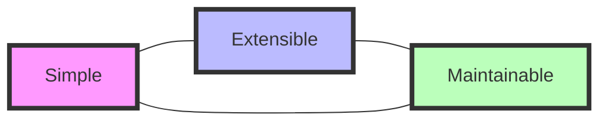
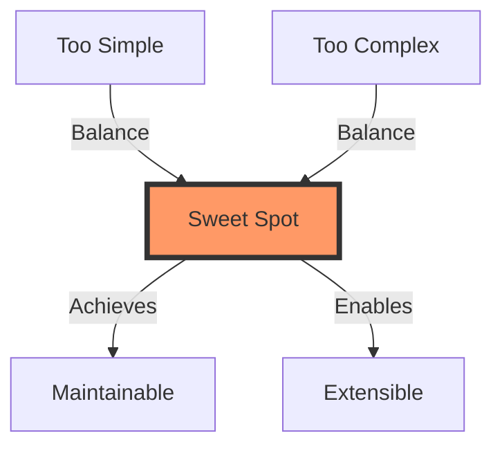

# 🎯 Database Connector Architecture

> *"Perfection is achieved, not when there is nothing more to add, but when there is nothing left to take away."* - Antoine de Saint-Exupéry

## 🏗️ Core Structure

```
db_connector/
├── 🔮 core/                  # Essential functionality
├── 📝 templates/             # Database configurations
├── 🛠️ utils/                # Core utilities
└── ⚡ optional/             # Simple extensions
```

## 🌟 Key Architectural Principles

### 1. 🎯 Core Simplicity

- Single responsibility per module
- No complex inheritance hierarchies
- Direct, functional approaches preferred
- Clear, intuitive interfaces

### 2. 🔗 Clear Dependencies

- Self-contained core modules
- Truly optional extensions
- No circular dependencies
- Minimal external requirements

### 3. 🚀 Extensibility Strategy

| Component | Extension Method |
|-----------|-----------------|
| Engines | Add to templates/ |
| Operations | Add to optional/ |
| Utilities | Add to utils/ |

### 4. 🛠️ Maintenance Benefits

- ✅ Easy to test core functionality
- 🐞 Simple to debug (clear paths)
- 📚 Easy for new developers
- 🧩 Modular updates possible

## 💫 Design Philosophy



## 🎨 Design Decisions

| Principle | Over |
|-----------|------|
| 📗 Functions | Complex Classes |
| 🎯 Direct Implementation | Abstractions |
| 🧩 Independent Modules | Tight Coupling |
| 💡 Simple Interfaces | Complex Patterns |
| 📝 Clear Names | Clever Ones |

## 🚀 Architecture Benefits

1. **Engine Integration** 🔌
   - Plug-and-play engine addition
   - Consistent interface across engines
   - Minimal boilerplate required

2. **Feature Integration** ⚡
   - Independent feature modules
   - Optional functionality
   - Clean core separation

3. **Testing** ✅
   - Clear boundaries
   - Isolated components
   - Simple mocking

4. **Maintenance** 🔧
   - Easy to understand
   - Simple to modify
   - Clear documentation

5. **Developer Experience** 👨‍💻
   - Quick onboarding
   - Clear patterns
   - Intuitive structure

## 🎯 The Sweet Spot



> *"The architecture maintains perfect balance between simplicity and extensibility, making it both powerful and maintainable."*

---

### 🌟 Key Takeaways

- **Simplicity** doesn't mean basic
- **Extensibility** doesn't mean complex
- **Balance** is the key to longevity

---

📚 *For detailed implementation examples and best practices, see the code documentation.*
