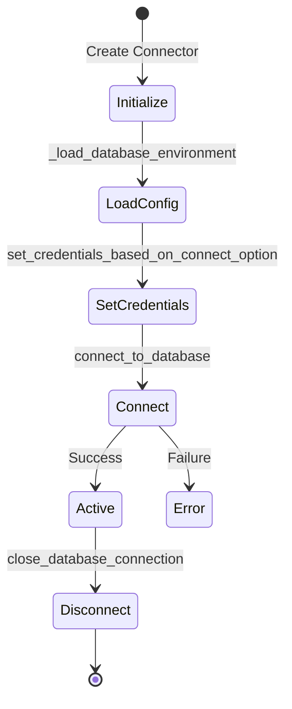
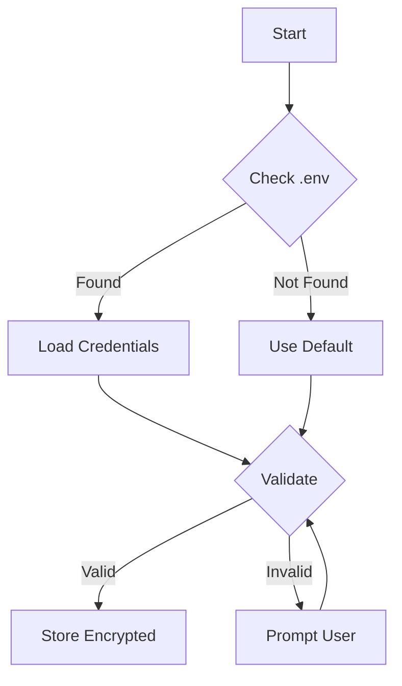
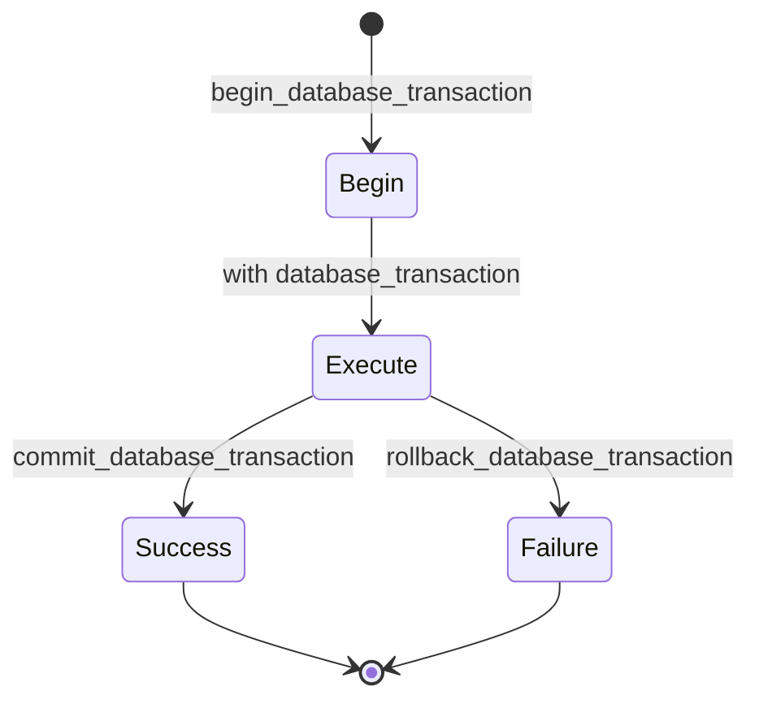
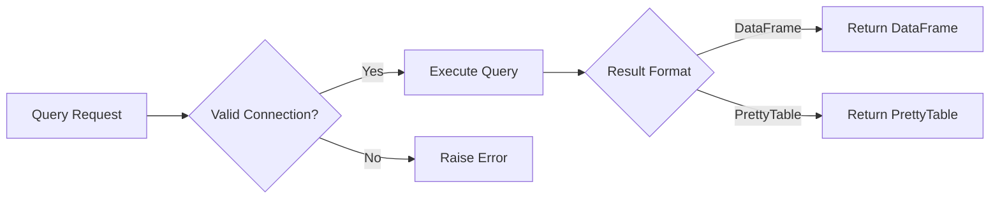
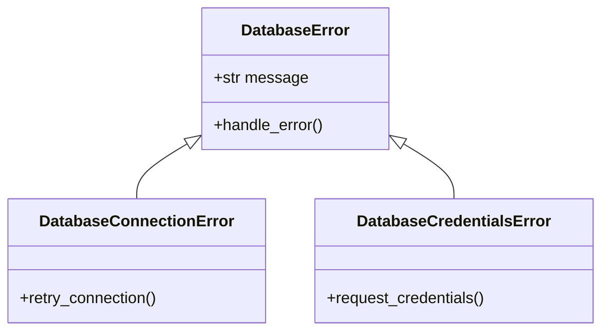
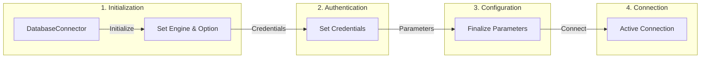
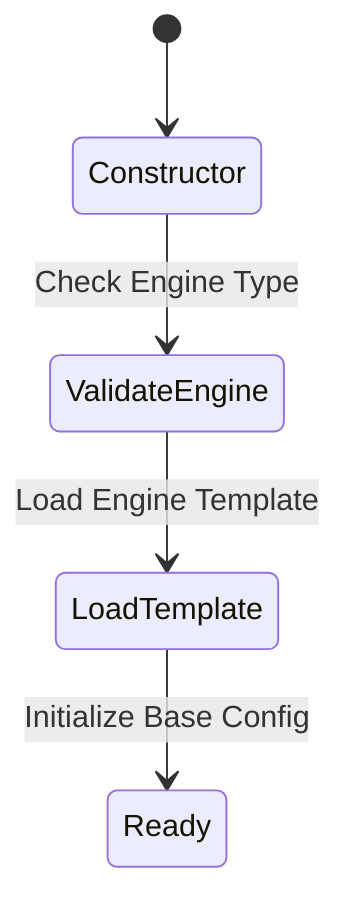
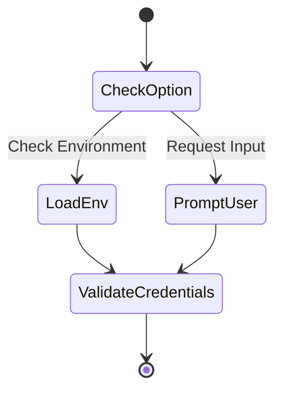
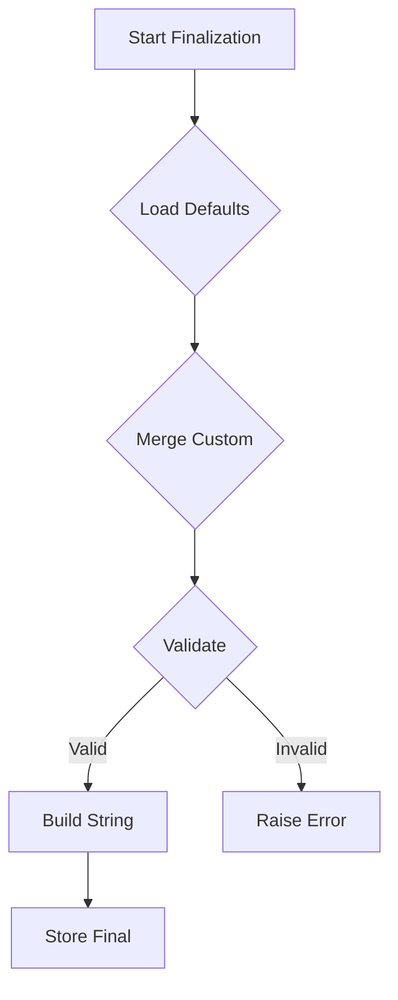
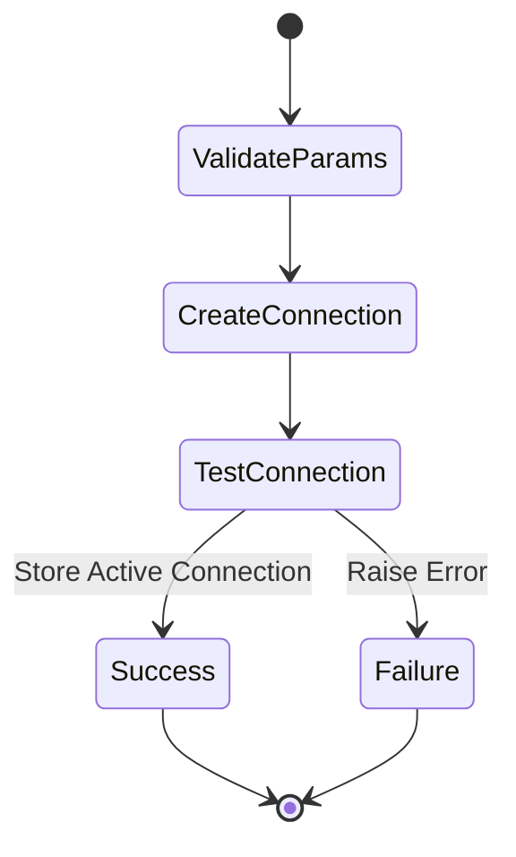

# Database Connector Workflow Documentation 📚

[🔙 Back to Top](#database-connector-workflow-documentation-)

## Table of Contents 📑

- [1. Connection Management](#1-connection-management-🔌)
- [2. Credential Handling](#2-credential-handling-🔑)
- [3. Transaction Management](#3-transaction-management-💱)
- [4. CRUD Operations](#4-crud-operations-📝)
- [5. Error Handling](#5-error-handling-⚠️)

## 1. Connection Management 🔌

[🔙 Back to Top](#database-connector-workflow-documentation-)

### Connection Lifecycle



### Connection Parameter Workflow

```python
@preload_default_parameters
def finalize_connection_parameters(self, **custom_params):
    """
    Finalizes database connection parameters with defaults and custom overrides
    
    Args:
        **custom_params: Custom connection parameters to override defaults
        
    Returns:
        Dict[str, Any]: Finalized connection parameters
    """
    # Internal workflow:
    # 1. Load default parameters from template
    # 2. Merge with custom parameters
    # 3. Validate required parameters
    # 4. Build connection string
```

## 2. Credential Handling 🔑

[🔙 Back to Top](#database-connector-workflow-documentation-)

### Credential Management Flow



### CredentialsDescriptor Usage

```python
class CredentialsDescriptor:
    """
    Descriptor for secure credential management
    
    Usage:
        _credentials = CredentialsDescriptor("credentials")
    
    Workflow:
        1. Encrypts credentials on set
        2. Decrypts credentials on get
        3. Validates credential format
    """
```

## 3. Transaction Management 💱

[🔙 Back to Top](#database-connector-workflow-documentation-)

### Transaction Context Manager



```python
@contextmanager
def database_transaction(self):
    """
    Database transaction context manager
    
    Usage:
        with db.database_transaction():
            db.execute_query(...)
            
    Workflow:
        1. Begin transaction
        2. Execute operations
        3. Auto-commit on success
        4. Auto-rollback on failure
    """
```

## 4. CRUD Operations 📝

[🔙 Back to Top](#database-connector-workflow-documentation-)

### Query Execution Flow



### Example CRUD Method

```python
def select_database_records(
    self,
    table_name: str,
    columns: Optional[List[str]] = None,
    where: Optional[Dict[str, Any]] = None
) -> List[Dict[str, Any]]:
    """
    Select records from database
    
    Internal Workflow:
        1. Build SELECT query
        2. Add WHERE clause if provided
        3. Execute query with cursor
        4. Convert results to dict format
        5. Return results
    """
```

## 5. Error Handling ⚠️

[🔙 Back to Top](#database-connector-workflow-documentation-)

### Error Hierarchy



### Error Handling Flow

```python
try:
    with self._database_cursor() as cursor:
        cursor.execute(query)
except DatabaseConnectionError as e:
    # Connection-specific error handling
    self._handle_connection_error(e)
except DatabaseCredentialsError as e:
    # Credential-specific error handling
    self._handle_credential_error(e)
except DatabaseError as e:
    # Generic database error handling
    self._handle_database_error(e)
```

This documentation provides a sample of how each module's workflow can be documented. Each section includes:

- Mermaid diagrams for visual representation
- Code examples with docstrings
- Internal workflow descriptions
- Error handling patterns
- Usage examples

# Core Database Connector Workflow 🔄

## Fluent Pattern Core Flow



## Step-by-Step Breakdown

```python
db = DatabaseConnector(
    TargetDatabaseEngine.MSSQL,                           # Step 1
    TargetDatabaseConnectionStringOption.Default_DSN_AndDefaultUserPwd  # Step 1
)\
    .set_credentials_based_on_connect_option(             # Step 2
        show_password=True
    )\
    ._finalized_connection_parameters()\                  # Step 3
    .connect_to_database()                               # Step 4
```

### 1. Initialization Phase



```python
class DatabaseConnector:
    def __init__(
        self,
        engine: TargetDatabaseEngine,
        connect_option: TargetDatabaseConnectionStringOption
    ):
        """
        Initialize database connector with specific engine and connection option
        
        Args:
            engine: Database engine type (e.g., MSSQL, PostgreSQL)
            connect_option: Connection string configuration option
        
        Internal Flow:
            1. Validate engine type
            2. Load engine-specific template
            3. Initialize base configuration
        """
```

### 2. Credential Management Phase



```python
def set_credentials_based_on_connect_option(
    self,
    show_password: bool = False
) -> 'DatabaseConnector':
    """
    Set credentials based on connection option
    
    Args:
        show_password: Whether to display password during input
        
    Returns:
        self: For method chaining
        
    Internal Flow:
        1. Check connection option type
        2. Load credentials from environment or prompt
        3. Validate credential format
        4. Store securely
    """
```

### 3. Parameter Finalization Phase



```python
def _finalized_connection_parameters(self) -> 'DatabaseConnector':
    """
    Finalize connection parameters
    
    Internal Flow:
        1. Load default parameters for engine
        2. Merge with custom parameters if any
        3. Validate required parameters
        4. Build connection string
        5. Store finalized parameters
        
    Returns:
        self: For method chaining
    """
```

### 4. Connection Establishment Phase



```python
def connect_to_database(self) -> 'DatabaseConnector':
    """
    Establish database connection
    
    Internal Flow:
        1. Validate finalized parameters
        2. Create connection object
        3. Test connection
        4. Store active connection
        
    Returns:
        self: For method chaining
        
    Raises:
        DatabaseConnectionError: If connection fails
    """
```

## Usage Example

```python
try:
    # Create and configure database connection
    db = DatabaseConnector(
        TargetDatabaseEngine.MSSQL,
        TargetDatabaseConnectionStringOption.Default_DSN_AndDefaultUserPwd
    )\
        .set_credentials_based_on_connect_option(show_password=True)\
        ._finalized_connection_parameters()\
        .connect_to_database()
    
    # Connection successful - ready for use
    with db.database_transaction():
        # Perform database operations
        results = db.execute_query("SELECT * FROM users")
        
except DatabaseConnectionError as e:
    # Handle connection errors
    logging.error(f"Failed to connect: {e}")
```

This documentation focuses on the core workflow while maintaining clarity through:

1. Clear visual progression
2. Step-by-step breakdowns
3. Detailed method documentation
4. Visual state diagrams
5. Practical usage examples

# Core Database Connector Workflow 🔄

## Fluent Pattern Core Flow


## Step-by-Step Breakdown

```python
db = DatabaseConnector(
    TargetDatabaseEngine.MSSQL,                           # Step 1
    TargetDatabaseConnectionStringOption.Default_DSN_AndDefaultUserPwd  # Step 1
)\
    .set_credentials_based_on_connect_option(             # Step 2
        show_password=True
    )\
    ._finalized_connection_parameters()\                  # Step 3
    .connect_to_database()                               # Step 4
```

### 1. Initialization Phase


```python
class DatabaseConnector:
    def __init__(
        self,
        engine: TargetDatabaseEngine,
        connect_option: TargetDatabaseConnectionStringOption
    ):
        """
        Initialize database connector with specific engine and connection option
        
        Args:
            engine: Database engine type (e.g., MSSQL, PostgreSQL)
            connect_option: Connection string configuration option
        
        Internal Flow:
            1. Validate engine type
            2. Load engine-specific template
            3. Initialize base configuration
        """
```

### 2. Credential Management Phase


```python
def set_credentials_based_on_connect_option(
    self,
    show_password: bool = False
) -> 'DatabaseConnector':
    """
    Set credentials based on connection option
    
    Args:
        show_password: Whether to display password during input
        
    Returns:
        self: For method chaining
        
    Internal Flow:
        1. Check connection option type
        2. Load credentials from environment or prompt
        3. Validate credential format
        4. Store securely
    """
```

### 3. Parameter Finalization Phase


```python
def _finalized_connection_parameters(self) -> 'DatabaseConnector':
    """
    Finalize connection parameters
    
    Internal Flow:
        1. Load default parameters for engine
        2. Merge with custom parameters if any
        3. Validate required parameters
        4. Build connection string
        5. Store finalized parameters
        
    Returns:
        self: For method chaining
    """
```

### 4. Connection Establishment Phase


```python
def connect_to_database(self) -> 'DatabaseConnector':
    """
    Establish database connection
    
    Internal Flow:
        1. Validate finalized parameters
        2. Create connection object
        3. Test connection
        4. Store active connection
        
    Returns:
        self: For method chaining
        
    Raises:
        DatabaseConnectionError: If connection fails
    """
```

## Usage Example

```python
try:
    # Create and configure database connection
    db = DatabaseConnector(
        TargetDatabaseEngine.MSSQL,
        TargetDatabaseConnectionStringOption.Default_DSN_AndDefaultUserPwd
    )\
        .set_credentials_based_on_connect_option(show_password=True)\
        ._finalized_connection_parameters()\
        .connect_to_database()
    
    # Connection successful - ready for use
    with db.database_transaction():
        # Perform database operations
        results = db.execute_query("SELECT * FROM users")
        
except DatabaseConnectionError as e:
    # Handle connection errors
    logging.error(f"Failed to connect: {e}")
```

This documentation focuses on the core workflow while maintaining clarity through:

1. Clear visual progression
2. Step-by-step breakdowns
3. Detailed method documentation
4. Visual state diagrams
5. Practical usage examples

Would you like me to:

1. Add more detail to any particular phase?
2. Include specific error handling scenarios?
3. Show additional configuration options?
