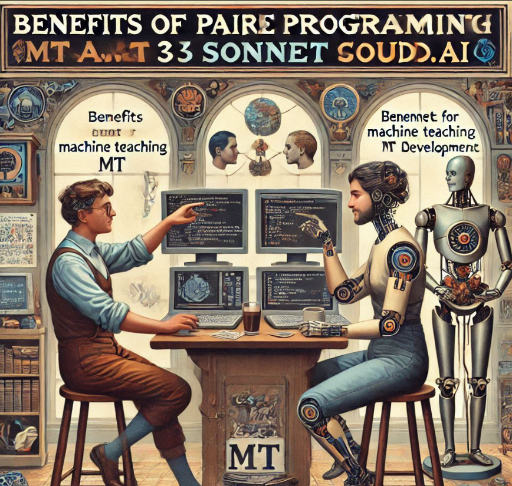

# Benefits of Pair Programming with Claude.ai 3.5 Sonnet for Machine Teaching (MT) Development

## Key Advantages of Collaborative AI-Assisted Development

* **Enhanced Design Precision**: Pair programming with Claude.ai 3.5 Sonnet provides a systematic approach to design conceptualization, leveraging advanced AI capabilities to generate more comprehensive and innovative architectural solutions. The AI's ability to quickly iterate through multiple design paradigms helps developers explore a wider range of potential approaches, identifying optimal strategies for Machine Teaching applications that might be overlooked in traditional development processes.

* **Accelerated Code Development**: By combining human creativity with Claude.ai's advanced language models, developers can significantly reduce development time and increase code quality. The AI assists in generating clean, efficient code snippets, providing real-time suggestions, identifying potential optimizations, and helping to implement complex algorithmic solutions with greater speed and accuracy than traditional solo programming methods.

* **Comprehensive Testing and Validation**: Claude.ai 3.5 Sonnet excels at generating exhaustive test cases and validation strategies, ensuring robust and reliable Machine Teaching implementations. The AI can systematically identify potential edge cases, generate comprehensive test scenarios, and provide detailed analysis of potential system vulnerabilities, thereby enhancing the overall quality and reliability of MT development.

* **Knowledge Transfer and Learning**: The collaborative process creates a dynamic learning environment where developers can gain insights from the AI's extensive knowledge base. Claude.ai provides contextual explanations, best practices, and alternative implementation strategies, effectively serving as an intelligent coding mentor that continuously expands the developer's understanding of Machine Teaching principles and advanced programming techniques.

* **Error Prevention and Code Quality Improvement**: With real-time code review and intelligent suggestion capabilities, Claude.ai 3.5 Sonnet acts as a proactive debugging partner. The AI can identify potential logical errors, suggest more efficient coding patterns, ensure adherence to best practices, and provide immediate feedback that helps prevent bugs and improve overall code quality before they become significant issues.

* **Scalability and Architectural Insights**: The AI's ability to analyze system requirements and provide architectural recommendations enables developers to design more scalable and flexible Machine Teaching solutions. Claude.ai can offer strategic insights into system design, helping to create modular, extensible architectures that can adapt to evolving technological and educational requirements.

## Conclusion

Pair programming with Claude.ai 3.5 Sonnet represents a transformative approach to Machine Teaching development, combining human intuition with advanced AI capabilities to create more innovative, efficient, and robust technological solutions.
