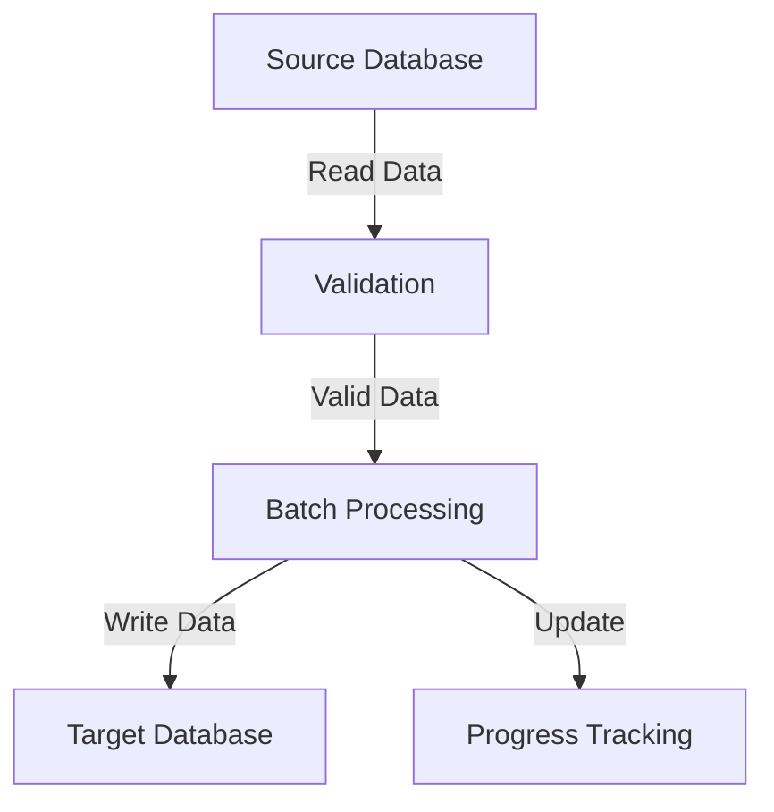

# 🔄 Multi-Database Data Transfer Implementation Guide

[🔝 Back to Top](#multi-database-data-transfer-implementation-guide)

## 📑 Table of Contents

1. [Overview](#overview)
2. [Core Components](#core-components)
3. [Key Features](#key-features)
4. [Function Details](#function-details)
5. [Data Flow](#data-flow)
6. [Error Handling](#error-handling)
7. [Best Practices](#best-practices)
8. [Usage Example](#usage-example)

## 🎯 Overview

A streamlined implementation for transferring data between different database systems, following KISS and Occam's Razor principles.

[🔝 Back to Top](#multi-database-data-transfer-implementation-guide)

## 🧩 Core Components

| Component | Purpose | Key Features |
|-----------|---------|--------------|
| MultiDatabaseConnector | Main connector class | Multiple database connections |
| Database Engines | Supported databases | SQLite, PostgreSQL, etc. |
| Transaction Management | Data integrity | Atomic operations |
| Batch Processing | Performance optimization | Chunked data transfer |

[🔝 Back to Top](#multi-database-data-transfer-implementation-guide)

## ⭐ Key Features

### 1. 🛡️ Data Validation

```python
def validate_source_data(data: pd.DataFrame, required_columns: List[str]) -> bool:
    # Validates data integrity
    # Returns True if valid, raises ValueError if not
```

### 2. 📦 Batch Processing

```python
def process_data_batch(
    db: MultiDatabaseConnector,
    target_alias: str,
    table_name: str,
    data: pd.DataFrame,
    batch_size: int = 1000
) -> int:
    # Processes data in manageable chunks
    # Returns total processed rows
```

### 3. 📊 Progress Tracking

```python
stats = {
    "start_time": datetime.now(),
    "total_rows": 0,
    "processed_rows": 0,
    "errors": [],
    "status": "started"
}
```

[🔝 Back to Top](#multi-database-data-transfer-implementation-guide)

## 🔍 Function Details

| Function | Purpose | Return Type |
|----------|---------|-------------|
| create_target_table | Creates table structure | None |
| validate_source_data | Validates input data | bool |
| process_data_batch | Handles batch processing | int |
| transfer_data | Orchestrates transfer | Dict[str, Any] |

### Detailed Function Analysis

#### 🏗️ create_target_table

- Creates table if not exists
- Handles column definitions
- Uses transaction context

#### 🔍 validate_source_data

- Checks required columns
- Validates null values
- Returns boolean status

[🔝 Back to Top](#multi-database-data-transfer-implementation-guide)

## 📊 Data Flow



[🔝 Back to Top](#multi-database-data-transfer-implementation-guide)

## ⚠️ Error Handling

| Error Type | Handling Strategy | Recovery |
|------------|------------------|-----------|
| DatabaseError | Transaction rollback | Automatic |
| ValidationError | Process termination | Manual |
| ConnectionError | Retry mechanism | Automatic |

[🔝 Back to Top](#multi-database-data-transfer-implementation-guide)

## 💡 Best Practices

1. **Connection Management**
   - Use context managers
   - Close connections properly
   - Handle multiple databases efficiently

2. **Data Handling**
   - Validate before transfer
   - Use batch processing
   - Track progress

3. **Error Management**
   - Proper exception handling
   - Detailed error logging
   - Transaction management

[🔝 Back to Top](#multi-database-data-transfer-implementation-guide)

## 📝 Usage Example

```python
# Initialize connector
multi_db = MultiDatabaseConnector()

# Attach databases
with multi_db as db:
    # Attach source
    db.attach_database("source", TargetDatabaseEngine.SQLITE3, ...)
    
    # Attach target
    db.attach_database("target", TargetDatabaseEngine.POSTGRESQL, ...)
    
    # Transfer data
    stats = transfer_data(
        db=db,
        source_alias="source",
        target_alias="target",
        source_query="SELECT * FROM source_table",
        target_table="target_table",
        column_mapping=column_mapping,
        batch_size=1000
    )
```

[🔝 Back to Top](#multi-database-data-transfer-implementation-guide)

---

## 📈 Performance Considerations

- Batch size optimization
- Connection pooling
- Index management
- Memory usage monitoring

[🔝 Back to Top](#multi-database-data-transfer-implementation-guide)
