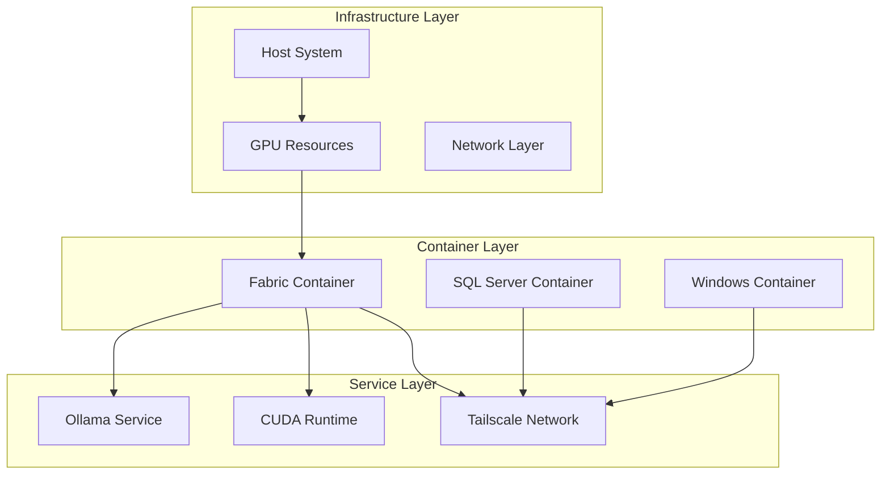

# 🐳 Docker Master Documentation Guide - Complete Edition

[⬆️ Back to Top](#)

## 📋 Vision Statement

Our mission is to provide a comprehensive, organized Docker environment implementation following KISS principles and Occam's Razor. By maintaining strict containerization standards and following best practices, we ensure maintainability, scalability, and robust functionality across all environments, with special attention to GPU optimization and cross-container integration.

## 📚 Table of Contents

### 1. [Core Docker Documentation](#core-docker-docs)

#### [Windows Container Implementation](Windows%20Container%20Documentation.md)

- [Core Setup](Windows%20Container%20Documentation.md#-core-setup)
- [Container Configuration](Windows%20Container%20Documentation.md#-container-configuration)
- [Network Setup](Windows%20Container%20Documentation.md#-network-setup)
- [Volume Management](Windows%20Container%20Documentation.md#-volume-management)

#### [SQL Server Container Implementation](SQL%20Server%20Documentation.md)

- [Ubuntu Setup](SQL%20Server%20Documentation.md#-ubuntu-setup)
- [SQL Server Configuration](SQL%20Server%20Documentation.md#-sql-server-configuration)
- [Data Persistence](SQL%20Server%20Documentation.md#-data-persistence)
- [Backup Solutions](SQL%20Server%20Documentation.md#-backup-solutions)

#### [Fabric Container Implementation](Fabric%20Documentation.md)

- [CUDA Support](Fabric%20Documentation.md#-cuda-support)
  - CUDA Toolkit Integration
  - Driver Requirements
  - Version Compatibility Matrix
  - Performance Optimization
- [Ollama Integration](Fabric%20Documentation.md#-ollama-integration)
  - Model Configuration
  - API Setup
  - Performance Tuning
  - Memory Management
- [GPU Configuration](Fabric%20Documentation.md#-gpu-configuration)
  - Device Selection
  - Resource Allocation
  - Multi-GPU Support
  - Monitoring Tools
- [Model Management](Fabric%20Documentation.md#-model-management)
  - Model Storage
  - Version Control
  - Deployment Strategies
  - Cache Management

### 2. [Implementation Documentation](#impl-docs)

#### [Docker Compose Patterns](Docker%20Compose%20Patterns.md)

- Windows Configuration
  - Service Definitions
  - Network Setup
  - Volume Mapping
- SQL Server Setup
  - Container Dependencies
  - Environment Variables
  - Health Checks
- Fabric CUDA Setup
  - GPU Device Mapping
  - Resource Limits
  - Runtime Requirements

#### [GPU and CUDA Configuration](GPU%20Configuration.md)

- Hardware Requirements
  - Supported GPU Models
  - Driver Versions
  - CUDA Compatibility
- Resource Allocation
  - Memory Limits
  - Compute Allocation
  - Shared Resources
- Performance Optimization
  - Kernel Settings
  - Memory Management
  - Cache Configuration
- Monitoring and Metrics
  - GPU Usage
  - Memory Utilization
  - Temperature Monitoring
  - Error Handling

#### [Ollama Integration Guide](Ollama%20Integration.md)

- Installation
  - Base Requirements
  - Container Setup
  - Version Management
- Configuration
  - API Settings
  - Model Parameters
  - Resource Allocation
- Performance Tuning
  - Batch Processing
  - Caching Strategies
  - Memory Optimization
- Integration Testing
  - API Validation
  - Load Testing
  - Error Handling

#### [Cross-Container Communication](Cross%20Container%20Communication.md)

- Network Architecture
  - Overlay Networks
  - Service Discovery
  - Load Balancing
- Security
  - Network Policies
  - Access Control
  - Certificate Management
- Performance
  - Connection Pooling
  - Request Routing
  - Caching Strategies
- Monitoring
  - Network Metrics
  - Latency Tracking
  - Error Logging

### 3. [Deployment Documentation](#deploy-docs)

#### [Build System](Build%20System%20Documentation.md)

- Windows Build Process
- SQL Server Build Process
- Fabric Build Process
  - CUDA Integration
  - GPU Support
  - Performance Optimization

#### [CI/CD Pipeline](CICD%20Pipeline%20Documentation.md)

- Build Automation
- Testing Strategy
- Deployment Workflow
- Monitoring Integration

### 4. [Resource Management](#resource-docs)

#### [GPU Resource Management](GPU%20Resource%20Management.md)

- Allocation Strategies
  - Dynamic Allocation
  - Static Assignment
  - Resource Quotas
- Monitoring
  - Usage Metrics
  - Performance Analytics
  - Alert Configuration
- Optimization
  - Memory Management
  - Compute Distribution
  - Cache Utilization

#### [Container Resource Management](Container%20Resource%20Management.md)

- CPU Allocation
- Memory Limits
- Storage Management
- Network Resources

## 🏗️ Project Structure

```
docker/
├── windows/                # Windows container configurations
├── ubuntu/                 # Ubuntu container configurations
│   └── sqlserver/         # SQL Server specific configs
├── fabric/                # Fabric container configurations
│   ├── cuda/             # CUDA configurations
│   │   ├── config/      # CUDA specific settings
│   │   └── drivers/     # GPU driver configurations
│   └── ollama/           # Ollama configurations
│       ├── models/      # Model configurations
│       └── api/         # API settings
├── gpu/                   # GPU management
│   ├── monitoring/       # GPU monitoring configs
│   └── optimization/     # Performance tuning
├── compose/               # Docker compose files
├── scripts/               # Management scripts
├── config/                # Configuration files
├── build/                 # Build system
└── docs/                  # Documentation
```

## 🔄 Workflow Integration



## 🛠️ Development Tools

### GPU Development

- NVIDIA System Management Interface
- CUDA Toolkit
- GPU Monitoring Tools
- Performance Profilers

### Container Development

- Docker Desktop
- Visual Studio Code with Docker Extension
- Docker Compose
- Container Monitoring Tools

## 📊 Performance Metrics

### GPU Metrics

- CUDA Processing Time
- Memory Utilization
- Temperature Monitoring
- Power Usage

### Container Metrics

- Resource Usage
- Network Performance
- Response Times
- Error Rates

[⬆️ Back to Top](#)

---
© 2024 Docker Environment
