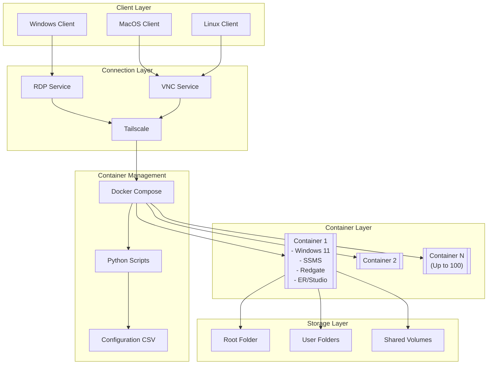
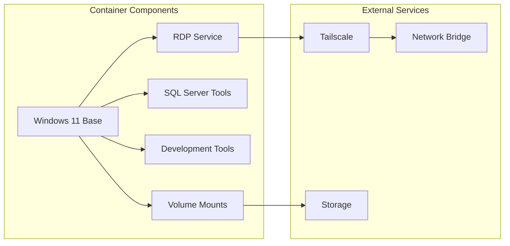
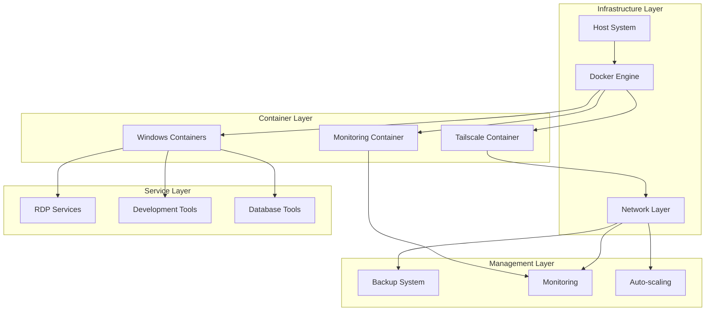

# Windows Docker Development Environment Setup Guide

## Table of Contents

1. [Executive Summary](#executive-summary)

2. [System Architecture](#system-architecture)
3. [Prerequisites](#prerequisites)
4. [Installation and Setup](#installation-and-setup)
5. [Configuration Files](#configuration-files)
6. [Build System](#build-system-1)
7. [Management Scripts](#management-scripts-1)
8. [Deployment Guide](#deployment-guide-1)
9. [Usage Instructions](#usage-instructions-1)
10. [Maintenance and Support](#maintenance-and-support-1)
11. [Troubleshooting](#troubleshooting-1)
12. [Security Considerations](#security-considerations-1)
13. [Appendices](#appendices-1)

## Executive Summary

This documentation provides comprehensive instructions for setting up and managing a Windows Docker container environment designed for educational settings. The solution supports up to 100 containers with pre-configured development tools, remote connectivity, and structured user management.

## System Architecture

## High-Level Architecture



## Container Architecture



# Prerequisites

## Hardware Requirements

- CPU: 4+ cores
- RAM: 16GB minimum
- Storage: 100GB+ available space
- Network: 1Gbps minimum

## Software Requirements

- Docker Desktop latest version
- Python 3.8+
- Git
- Tailscale account and authkey

## Required Installers

- RedgateSQLToolbelt.exe
- ERStudio_Data_Architect_20.3.0_Windows_Client_64bit.exe
- Windows 11 base image

# Installation and Setup

## Directory Structure

```
project_root/
├── Dockerfile
├── docker-compose.yml
├── build.py
├── setup_build.py
├── README.md
├── installers/
│   ├── RedgateSQLToolbelt.exe
│   └── ERStudio_Data_Architect_20.3.0_Windows_Client_64bit.exe
├── scripts/
│   ├── startup.ps1
│   ├── health-check.ps1
│   ├── backup.ps1
│   └── restore.ps1
├── config/
│   ├── container-config.csv
│   └── .env.template
└── volumes/
    ├── root/
    ├── users/
    └── shared/
```

# Configuration Files

## Docker Compose Configuration

```yaml
version: "3.8"

services:
  windows-dev:
    build:
      context: .
      dockerfile: Dockerfile
      args:
        - USERNAME=${DOCKER_USERNAME}
        - EMAIL=${CUNY_QMAIL_LOGIN}
        - WINDOWS_VERSION=11
    image: windows-dev-environment:${TAG:-latest}
    container_name: ${CONTAINER_NAME:-win-dev}
    hostname: ${HOSTNAME}
    ports:
      - "${EXTERNAL_PORT}:3389"
      - "${ADMINISTRATIVE_EXTERNAL_PORT}:3390"
    volumes:
      - ${VOLUME_LOCATION}/root:/root:rw
      - ${VOLUME_LOCATION}/users/${DOCKER_USERNAME}:/home/user:rw
      - ${VOLUME_LOCATION}/shared:/shared:rw
      - ${VOLUME_LOCATION}/backup:/backup:rw
    environment:
      - GIT_USERNAME=${DOCKER_USERNAME}
      - GIT_EMAIL=${CUNY_QMAIL_LOGIN}
      - TS_AUTHKEY=${TS_AUTHKEY}
      - TZ=${TIMEZONE:-America/New_York}
      - DISPLAY=${DISPLAY:-:0}
    deploy:
      resources:
        limits:
          cpus: '${CPU_LIMIT:-2}'
          memory: ${MEMORY_LIMIT:-8G}
        reservations:
          cpus: '1'
          memory: 4G
    networks:
      - dev-network
    depends_on:
      - tailscale
    restart: unless-stopped
    healthcheck:
      test: ["CMD", "powershell", "-Command", "Test-NetConnection -ComputerName localhost -Port 3389"]
      interval: 30s
      timeout: 10s
      retries: 3

  tailscale:
    image: tailscale/tailscale:latest
    container_name: ts-${HOSTNAME}
    hostname: ts-${HOSTNAME}
    environment:
      - TS_AUTHKEY=${TS_AUTHKEY}
      - TS_EXTRA_ARGS=--advertise-tags=tag:windows-container
      - TS_STATE_DIR=/var/lib/tailscale
      - TS_USERSPACE=false
    volumes:
      - ${PWD}/tailscale/state:/var/lib/tailscale
      - /dev/net/tun:/dev/net/tun
    cap_add:
      - net_admin
      - sys_module
    restart: unless-stopped
    networks:
      - dev-network
    healthcheck:
      test: ["CMD", "tailscale", "status"]
      interval: 60s
      timeout: 10s
      retries: 3

networks:
  dev-network:
    driver: bridge
    ipam:
      config:
        - subnet: 172.28.0.0/16
```

# Multi-Stage Dockerfile

```dockerfile
# escape=`

# Stage 1: Download and prepare installers
FROM mcr.microsoft.com/windows/servercore:ltsc2022 AS downloader
SHELL ["powershell", "-Command", "$ErrorActionPreference = 'Stop'; $ProgressPreference = 'SilentlyContinue';"]

# Create download directory
WORKDIR C:/downloads

# Download Chocolatey installer
RUN Invoke-WebRequest -Uri 'https://chocolatey.org/install.ps1' -OutFile 'chocolatey-install.ps1'

# Download SQL Server Management Studio offline installer (includes Azure Data Studio)
RUN Invoke-WebRequest -Uri 'https://aka.ms/ssmsfullsetup' -OutFile 'SSMS-Setup.exe'

# Stage 2: Base Windows configuration
FROM mcr.microsoft.com/windows:11 AS base
SHELL ["powershell", "-Command", "$ErrorActionPreference = 'Stop'; $ProgressPreference = 'SilentlyContinue';"]

# Copy installers from downloader stage
COPY --from=downloader C:/downloads C:/setup

# Copy local installers
COPY installers/RedgateSQLToolbelt.exe C:/setup/
COPY installers/ERStudio_Data_Architect_20.3.0_Windows_Client_64bit.exe C:/setup/

# Install Windows features
RUN Install-WindowsFeature -Name `
    RDS-RD-Server, `
    NET-Framework-45-Core, `
    Windows-Identity-Foundation, `
    Server-Media-Foundation

# Stage 3: Development tools installation
FROM base AS devtools

# Install Chocolatey
RUN Set-ExecutionPolicy Bypass -Scope Process -Force; `
    & C:/setup/chocolatey-install.ps1

# Install development tools via Chocolatey
RUN choco install -y --no-progress `
    git `
    googlechrome `
    vscode `
    python `
    nodejs `
    7zip

# Stage 4: Database tools installation
FROM devtools AS dbtools

# Arguments for customization
ARG USERNAME
ARG EMAIL
ARG WINDOWS_VERSION=11

# Environment variables
ENV DOCKER_USERNAME=$USERNAME
ENV CUNY_QMAIL_LOGIN=$EMAIL
ENV TEMP_DIR=C:/temp
ENV INSTALL_DIR=C:/Program Files

# Install SSMS (offline installer)
RUN Start-Process -Wait -FilePath "C:\setup\SSMS-Setup.exe" `
    -ArgumentList "/install", "/quiet", "/norestart" `
    -NoNewWindow

# Install Redgate SQL Toolbelt (silent installation)
RUN Start-Process -Wait -FilePath "C:\setup\RedgateSQLToolbelt.exe" `
    -ArgumentList "/IAgreeToTheEula", "/quiet", "/log", "C:\setup\redgate-install.log" `
    -NoNewWindow

# Install ER/Studio
RUN Start-Process -Wait -FilePath "C:\setup\ERStudio_Data_Architect_20.3.0_Windows_Client_64bit.exe" `
    -ArgumentList "/s", "/v/qn", "/log", "C:\setup\erstudio-install.log" `
    -NoNewWindow

# Stage 5: Final configuration
FROM dbtools AS final

# Create directory structure
RUN New-Item -ItemType Directory -Force -Path `
    C:\root, `
    C:\users, `
    C:\shared, `
    C:\backup, `
    C:\logs

# Configure RDP
RUN Set-ItemProperty -Path 'HKLM:\System\CurrentControlSet\Control\Terminal Server' -Name "fDenyTSConnections" -Value 0; `
    Set-ItemProperty -Path 'HKLM:\System\CurrentControlSet\Control\Terminal Server\WinStations\RDP-Tcp' -Name "UserAuthentication" -Value 1; `
    Enable-NetFirewallRule -DisplayGroup "Remote Desktop"

# Configure Git
RUN git config --system user.name $env:DOCKER_USERNAME; `
    git config --system user.email $env:CUNY_QMAIL_LOGIN

# Set permissions
RUN $acl = Get-Acl C:\users; `
    $rule = New-Object System.Security.AccessControl.FileSystemAccessRule("Users", "Modify", "ContainerInherit,ObjectInherit", "None", "Allow"); `
    $acl.SetAccessRule($rule); `
    Set-Acl C:\users $acl

# Configure Windows settings
RUN Set-TimeZone -Id "Eastern Standard Time"; `
    Set-WinSystemLocale -SystemLocale en-US; `
    Set-WinUserLanguageList -LanguageList en-US -Force

# Clean up
RUN Remove-Item C:\setup -Recurse -Force; `
    Remove-Item $env:TEMP\* -Recurse -Force

# Copy management scripts
COPY scripts/startup.ps1 C:/scripts/
COPY scripts/health-check.ps1 C:/scripts/
COPY scripts/backup.ps1 C:/scripts/
COPY scripts/restore.ps1 C:/scripts/

# Set script execution policy
RUN Set-ExecutionPolicy -ExecutionPolicy RemoteSigned -Force

# Set working directory
WORKDIR C:\users

# Expose ports
EXPOSE 3389
EXPOSE 3390

# Health check
HEALTHCHECK --interval=30s --timeout=10s --start-period=60s --retries=3 `
    CMD powershell -File C:/scripts/health-check.ps1

# Start command
CMD ["powershell", "-File", "C:/scripts/startup.ps1"]
```

# Build System Scripts

## setup_build.py

```python
import os
import sys
import hashlib
import logging
from pathlib import Path
from typing import Dict, List, Optional

class BuildSetup:
    def __init__(self):
        self.root_dir = Path(__file__).parent
        self.installers_dir = self.root_dir / "installers"
        self.scripts_dir = self.root_dir / "scripts"
        self.config_dir = self.root_dir / "config"
        self.logs_dir = self.root_dir / "logs"

        # Configure logging
        self.setup_logging()

        # Define required components
        self.required_files = {
            "installers": {
                "RedgateSQLToolbelt.exe": {
                    "required": True,
                    "min_size_mb": 100,
                    "description": "Redgate SQL Toolbelt Installer"
                },
                "ERStudio_Data_Architect_20.3.0_Windows_Client_64bit.exe": {
                    "required": True,
                    "min_size_mb": 500,
                    "description": "ER/Studio Data Architect Installer"
                }
            },
            "scripts": {
                "startup.ps1": {"required": True},
                "health-check.ps1": {"required": True},
                "backup.ps1": {"required": True},
                "restore.ps1": {"required": True}
            },
            "config": {
                "container-config.csv": {"required": True},
                ".env": {"required": False}
            }
        }

    def setup_logging(self):
        """Configure logging system"""
        self.logs_dir.mkdir(exist_ok=True)
        logging.basicConfig(
            level=logging.INFO,
            format='%(asctime)s - %(levelname)s - %(message)s',
            handlers=[
                logging.FileHandler(self.logs_dir / 'build_setup.log'),
                logging.StreamHandler()
            ]
        )

    def validate_directory_structure(self) -> bool:
        """Create and validate required directories"""
        try:
            dirs = [self.installers_dir, self.scripts_dir, self.config_dir]
            for dir_path in dirs:
                dir_path.mkdir(exist_ok=True)
                logging.info(f"Validated directory: {dir_path}")
            return True
        except Exception as e:
            logging.error(f"Error creating directory structure: {e}")
            return False

    def check_file_size(self, file_path: Path, min_size_mb: int) -> bool:
        """Verify file meets minimum size requirements"""
        try:
            size_mb = file_path.stat().st_size / (1024 * 1024)
            return size_mb >= min_size_mb
        except Exception as e:
            logging.error(f"Error checking file size for {file_path}: {e}")
            return False

    def validate_installers(self) -> Dict[str, bool]:
        """Check required installers presence and validity"""
        results = {}
        for installer, props in self.required_files["installers"].items():
            file_path = self.installers_dir / installer
            if file_path.exists():
                size_valid = self.check_file_size(file_path, props["min_size_mb"])
                results[installer] = size_valid
                status = "Valid" if size_valid else "Invalid size"
                logging.info(f"Installer {installer}: {status}")
            else:
                results[installer] = False
                level = logging.ERROR if props["required"] else logging.WARNING
                logging.log(level, f"Installer {installer} not found")
        return results

    def create_env_template(self):
        """Create .env template if missing"""
        env_path = self.config_dir / ".env"
        if not env_path.exists():
            env_template = """
DOCKER_USERNAME=
CUNY_QMAIL_LOGIN=
PASSWORD=
HOSTNAME=win-dev
EXTERNAL_PORT=3389
ADMINISTRATIVE_EXTERNAL_PORT=3390
VOLUME_LOCATION=/volumes
TS_AUTHKEY=
CPU_LIMIT=2
MEMORY_LIMIT=8G
TIMEZONE=America/New_York
"""
            env_path.write_text(env_template.strip())
            logging.info("Created .env template")

    def create_script_templates(self):
        """Create script templates if missing"""
        script_templates = {
            "startup.ps1": self.get_startup_script_template(),
            "health-check.ps1": self.get_health_check_script_template(),
            "backup.ps1": self.get_backup_script_template(),
            "restore.ps1": self.get_restore_script_template()
        }

        for script_name, content in script_templates.items():
            script_path = self.scripts_dir / script_name
            if not script_path.exists():
                script_path.write_text(content)
                logging.info(f"Created script template: {script_name}")


```

# Build System Scripts (continued)

## setup_build.py (continued)

```python
    def get_startup_script_template(self) -> str:
        """Return template for startup script"""
        return '''# Startup Script Template
$ErrorActionPreference = "Stop"
$LogFile = "C:\logs\startup.log"

function Write-Log {
    param($Message)
    $LogMessage = "$(Get-Date -Format 'yyyy-MM-dd HH:mm:ss'): $Message"
    Add-Content -Path $LogFile -Value $LogMessage
    Write-Host $LogMessage
}

function Initialize-Environment {
    Write-Log "Initializing environment..."
    
    # Required services
    $services = @(
        "TermService",          # Remote Desktop Services
        "RpcSs",               # Remote Procedure Call
        "AudioSrv",            # Windows Audio
        "Dhcp",                # DHCP Client
        "DPS",                 # Diagnostic Policy Service
        "iphlpsvc",            # IP Helper
        "LanmanServer",        # Server
        "LanmanWorkstation",   # Workstation
        "RpcEptMapper",        # RPC Endpoint Mapper
        "Dnscache",            # DNS Client
        "EventLog"             # Windows Event Log
    )
    
    foreach ($service in $services) {
        try {
            Write-Log "Starting service: $service"
            Start-Service -Name $service
        } catch {
            Write-Log "Error starting service $service`: $_"
        }
    }
}

function Test-Environment {
    Write-Log "Testing environment..."
    
    # Test RDP port
    $rdpTest = Test-NetConnection -ComputerName localhost -Port 3389 -WarningAction SilentlyContinue
    if (-not $rdpTest.TcpTestSucceeded) {
        Write-Log "Warning: RDP port test failed"
    }
    
    # Test disk space
    $disk = Get-WmiObject Win32_LogicalDisk -Filter "DeviceID='C:'"
    $freeSpaceGB = [math]::Round($disk.FreeSpace / 1GB, 2)
    Write-Log "Free disk space: $freeSpaceGB GB"
}

try {
    Initialize-Environment
    Test-Environment
    Write-Log "Startup completed successfully"
    
    while ($true) {
        Start-Sleep -Seconds 60
    }
} catch {
    Write-Log "Fatal error during startup: $_"
    exit 1
}
'''

    def get_health_check_script_template(self) -> str:
        """Return template for health check script"""
        return '''# Health Check Script Template
$ErrorActionPreference = "Stop"
$LogFile = "C:\logs\health-check.log"

function Write-Log {
    param($Message)
    $LogMessage = "$(Get-Date -Format 'yyyy-MM-dd HH:mm:ss'): $Message"
    Add-Content -Path $LogFile -Value $LogMessage
    Write-Host $LogMessage
}

function Test-ContainerHealth {
    # Check RDP service
    $rdpService = Get-Service -Name "TermService"
    if ($rdpService.Status -ne "Running") {
        throw "RDP service is not running"
    }
    
    # Check critical services
    $services = @("RpcSs", "AudioSrv", "Dnscache")
    foreach ($service in $services) {
        $status = (Get-Service -Name $service).Status
        if ($status -ne "Running") {
            throw "Service $service is not running"
        }
    }
    
    # Check disk space
    $disk = Get-WmiObject Win32_LogicalDisk -Filter "DeviceID='C:'"
    $freeSpaceGB = [math]::Round($disk.FreeSpace / 1GB, 2)
    if ($freeSpaceGB -lt 10) {
        throw "Low disk space: $freeSpaceGB GB remaining"
    }
    
    # Check memory
    $os = Get-WmiObject Win32_OperatingSystem
    $freeMemoryGB = [math]::Round($os.FreePhysicalMemory / 1MB, 2)
    if ($freeMemoryGB -lt 1) {
        throw "Low memory: $freeMemoryGB GB remaining"
    }
    
    return $true
}

try {
    Test-ContainerHealth
    Write-Log "Health check passed"
    exit 0
} catch {
    Write-Log "Health check failed: $_"
    exit 1
}
'''

## build.py
```python
import os
import sys
import subprocess
import logging
from pathlib import Path
from datetime import datetime
from typing import Optional, Dict, List
from setup_build import BuildSetup

class DockerBuilder:
    def __init__(self):
        self.setup = BuildSetup()
        self.root_dir = Path(__file__).parent
        self.logs_dir = self.root_dir / "logs"
        self.setup_logging()

    def setup_logging(self):
        """Configure logging system"""
        self.logs_dir.mkdir(exist_ok=True)
        logging.basicConfig(
            level=logging.INFO,
            format='%(asctime)s - %(levelname)s - %(message)s',
            handlers=[
                logging.FileHandler(self.logs_dir / 'docker_build.log'),
                logging.StreamHandler()
            ]
        )

    def check_docker_running(self) -> bool:
        """Verify Docker daemon is running"""
        try:
            subprocess.run(
                ["docker", "info"],
                capture_output=True,
                check=True,
                text=True
            )
            logging.info("Docker daemon is running")
            return True
        except subprocess.CalledProcessError as e:
            logging.error(f"Docker daemon is not running: {e}")
            return False

    def check_disk_space(self, required_gb: int = 10) -> bool:
        """Check if sufficient disk space is available"""
        try:
            if os.name == 'nt':  # Windows
                import ctypes
                free_bytes = ctypes.c_ulonglong(0)
                ctypes.windll.kernel32.GetDiskFreeSpaceExW(
                    ctypes.c_wchar_p(str(self.root_dir)), 
                    None, None, 
                    ctypes.pointer(free_bytes)
                )
                free_gb = free_bytes.value / (1024**3)
            else:  # Unix-like
                stat = os.statvfs(str(self.root_dir))
                free_gb = (stat.f_frsize * stat.f_bavail) / (1024**3)

            if free_gb < required_gb:
                logging.error(f"Insufficient disk space. Required: {required_gb}GB, Available: {free_gb:.2f}GB")
                return False
            
            logging.info(f"Sufficient disk space available: {free_gb:.2f}GB")
            return True
            
        except Exception as e:
            logging.error(f"Error checking disk space: {e}")
            return False

    def build_image(self, tag: Optional[str] = None, no_cache: bool = False) -> bool:
        """Build Docker image with optional tag"""
        try:
            cmd = ["docker-compose", "build"]
            if tag:
                cmd.extend(["--build-arg", f"TAG={tag}"])
            if no_cache:
                cmd.append("--no-cache")
            
            logging.info(f"Building Docker image with command: {' '.join(cmd)}")
            
            process = subprocess.Popen(
                cmd,
                stdout=subprocess.PIPE,
                stderr=subprocess.PIPE,
                universal_newlines=True
            )

            # Stream output in real-time
            while True:
                output = process.stdout.readline()
                if output == '' and process.poll() is not None:
                    break
                if output:
                    logging.info(output.strip())

            returncode = process.poll()
            
            if returncode == 0:
                logging.info("Docker image built successfully")
                return True
            else:
                error = process.stderr.read()
                logging.error(f"Docker image build failed with error: {error}")
                return False
                
        except subprocess.CalledProcessError as e:
            logging.error(f"Error building Docker image: {e}")
            return False


```

# Build Script Methods (continued)

## build.py (continued)

```python
    def run_container(self, name: Optional[str] = None) -> bool:
        """Start the container using docker-compose"""
        try:
            cmd = ["docker-compose", "up", "-d"]
            if name:
                cmd.append(name)
            
            logging.info(f"Starting container with command: {' '.join(cmd)}")
            
            process = subprocess.Popen(
                cmd,
                stdout=subprocess.PIPE,
                stderr=subprocess.PIPE,
                universal_newlines=True
            )

            # Stream output in real-time
            while True:
                output = process.stdout.readline()
                if output == '' and process.poll() is not None:
                    break
                if output:
                    logging.info(output.strip())

            returncode = process.poll()
            
            if returncode == 0:
                logging.info("Container started successfully")
                return True
            else:
                error = process.stderr.read()
                logging.error(f"Container failed to start with error: {error}")
                return False

        except subprocess.CalledProcessError as e:
            logging.error(f"Error starting container: {e}")
            return False

    def stop_container(self, name: Optional[str] = None) -> bool:
        """Stop the container using docker-compose"""
        try:
            cmd = ["docker-compose", "down"]
            if name:
                cmd.append(name)
            
            logging.info(f"Stopping container with command: {' '.join(cmd)}")
            
            result = subprocess.run(cmd, capture_output=True, text=True)
            
            if result.returncode == 0:
                logging.info("Container stopped successfully")
                return True
            else:
                logging.error(f"Container failed to stop with error: {result.stderr}")
                return False

        except subprocess.CalledProcessError as e:
            logging.error(f"Error stopping container: {e}")
            return False

    def backup_container(self, backup_name: Optional[str] = None) -> bool:
        """Create backup of container volumes"""
        try:
            timestamp = datetime.now().strftime('%Y%m%d_%H%M%S')
            backup_name = backup_name or f"backup_{timestamp}"
            backup_dir = self.root_dir / "backups" / backup_name
            
            logging.info(f"Creating backup in: {backup_dir}")
            
            # Ensure backup directory exists
            backup_dir.mkdir(parents=True, exist_ok=True)
            
            # Get list of volumes from docker-compose
            cmd = ["docker-compose", "config", "--volumes"]
            result = subprocess.run(cmd, capture_output=True, text=True)
            
            if result.returncode != 0:
                logging.error(f"Failed to get volume list: {result.stderr}")
                return False
            
            volumes = result.stdout.strip().split('\n')
            
            # Backup each volume
            for volume in volumes:
                volume = volume.strip()
                if not volume:
                    continue
                    
                volume_backup_path = backup_dir / volume
                volume_backup_path.mkdir(parents=True, exist_ok=True)
                
                # Create tar archive of volume
                cmd = [
                    "docker", "run", "--rm",
                    "-v", f"{volume}:/source:ro",
                    "-v", f"{volume_backup_path}:/backup",
                    "alpine",
                    "tar", "czf", f"/backup/{volume}.tar.gz", "-C", "/source", "."
                ]
                
                result = subprocess.run(cmd, capture_output=True, text=True)
                
                if result.returncode != 0:
                    logging.error(f"Failed to backup volume {volume}: {result.stderr}")
                    return False
                    
                logging.info(f"Successfully backed up volume: {volume}")
            
            logging.info(f"Backup completed successfully: {backup_name}")
            return True
            
        except Exception as e:
            logging.error(f"Error creating backup: {e}")
            return False

    def restore_backup(self, backup_name: str) -> bool:
        """Restore container volumes from backup"""
        try:
            backup_dir = self.root_dir / "backups" / backup_name
            
            if not backup_dir.exists():
                logging.error(f"Backup directory not found: {backup_dir}")
                return False
            
            logging.info(f"Restoring backup from: {backup_dir}")
            
            # Stop running containers
            self.stop_container()
            
            # Get list of volumes from docker-compose
            cmd = ["docker-compose", "config", "--volumes"]
            result = subprocess.run(cmd, capture_output=True, text=True)
            
            if result.returncode != 0:
                logging.error(f"Failed to get volume list: {result.stderr}")
                return False
            
            volumes = result.stdout.strip().split('\n')
            
            # Restore each volume
            for volume in volumes:
                volume = volume.strip()
                if not volume:
                    continue
                
                backup_file = backup_dir / volume / f"{volume}.tar.gz"
                
                if not backup_file.exists():
                    logging.error(f"Backup file not found for volume {volume}")
                    continue
                
                # Clear existing volume
                cmd = [
                    "docker", "run", "--rm",
                    "-v", f"{volume}:/target",
                    "alpine",
                    "rm", "-rf", "/target/*"
                ]
                
                result = subprocess.run(cmd, capture_output=True, text=True)
                
                if result.returncode != 0:
                    logging.error(f"Failed to clear volume {volume}: {result.stderr}")
                    return False
                
                # Restore from backup
                cmd = [
                    "docker", "run", "--rm",
                    "-v", f"{volume}:/target",
                    "-v", f"{backup_file}:/backup.tar.gz:ro",
                    "alpine",
                    "tar", "xzf", "/backup.tar.gz", "-C", "/target"
                ]
                
                result = subprocess.run(cmd, capture_output=True, text=True)
                
                if result.returncode != 0:
                    logging.error(f"Failed to restore volume {volume}: {result.stderr}")
                    return False
                    
                logging.info(f"Successfully restored volume: {volume}")
            
            # Restart containers
            self.run_container()
            
            logging.info(f"Restore completed successfully from backup: {backup_name}")
            return True
            
        except Exception as e:
            logging.error(f"Error restoring backup: {e}")
            return False

def main():
    import argparse
    
    parser = argparse.ArgumentParser(description="Build and manage Windows Docker development environment")
    parser.add_argument("--tag", help="Optional tag for Docker image")
    parser.add_argument("--start", action="store_true", help="Start container after build")
    parser.add_argument("--stop", action="store_true", help="Stop running containers")
    parser.add_argument("--backup", help="Create backup with specified name")
    parser.add_argument("--restore", help="Restore from specified backup")
    parser.add_argument("--no-cache", action="store_true", help="Build without using cache")
    parser.add_argument("--validate-only", action="store_true", help="Only run validation")
    
    args = parser.parse_args()
    
    builder = DockerBuilder()
    
    if args.validate_only:
        success = builder.setup.validate_environment()
    elif args.stop:
        success = builder.stop_container()
    elif args.backup:
        success = builder.backup_container(args.backup)
    elif args.restore:
        success = builder.restore_backup(args.restore)
    else:
        if not builder.setup.validate_environment():
            sys.exit(1)
        
        success = builder.build_image(args.tag, args.no_cache)
        if success and args.start:
            success = builder.run_container()
    
    sys.exit(0 if success else 1)

if __name__ == "__main__":
    main()
```

# PowerShell Management Scripts

## backup.ps1

```powershell
<#
.SYNOPSIS
    Backup script for Windows Docker development environment
.DESCRIPTION
    Creates backups of container volumes and configuration
#>

param(
    [Parameter(Mandatory=$false)]
    [string]$BackupName = "backup_$(Get-Date -Format 'yyyyMMdd_HHmmss')",
    
    [Parameter(Mandatory=$false)]
    [string]$BackupPath = "C:\backup"
)

$ErrorActionPreference = "Stop"
$LogFile = "C:\logs\backup.log"


```

# PowerShell Management Scripts (continued)

## backup.ps1 (continued)

```powershell
function Write-Log {
    param($Message)
    $LogMessage = "$(Get-Date -Format 'yyyy-MM-dd HH:mm:ss'): $Message"
    Add-Content -Path $LogFile -Value $LogMessage
    Write-Host $LogMessage
}

function Test-BackupPrerequisites {
    # Check backup directory
    if (-not (Test-Path $BackupPath)) {
        New-Item -ItemType Directory -Path $BackupPath -Force
    }
    
    # Check available space
    $disk = Get-WmiObject Win32_LogicalDisk -Filter "DeviceID='$($BackupPath[0])':'"
    $freeSpaceGB = [math]::Round($disk.FreeSpace / 1GB, 2)
    
    if ($freeSpaceGB -lt 10) {
        throw "Insufficient disk space for backup. Required: 10GB, Available: $freeSpaceGB GB"
    }
}

function Backup-UserData {
    $backupDestination = Join-Path $BackupPath $BackupName
    
    # Create backup folders
    $folders = @(
        "root",
        "users",
        "shared",
        "config"
    )
    
    foreach ($folder in $folders) {
        $source = "C:\$folder"
        $destination = Join-Path $backupDestination $folder
        
        if (Test-Path $source) {
            Write-Log "Backing up $folder..."
            Copy-Item -Path $source -Destination $destination -Recurse -Force
        }
    }
    
    # Backup configuration files
    Copy-Item "C:\scripts\*.ps1" -Destination (Join-Path $backupDestination "scripts") -Force
    Copy-Item "C:\config\*.csv" -Destination (Join-Path $backupDestination "config") -Force
    
    # Create backup manifest
    $manifest = @{
        BackupName = $BackupName
        CreatedAt = Get-Date -Format "yyyy-MM-dd HH:mm:ss"
        Contents = $folders
        Size = (Get-ChildItem $backupDestination -Recurse | Measure-Object -Property Length -Sum).Sum
    }
    
    $manifest | ConvertTo-Json | Set-Content (Join-Path $backupDestination "manifest.json")
}

try {
    Write-Log "Starting backup process: $BackupName"
    Test-BackupPrerequisites
    Backup-UserData
    Write-Log "Backup completed successfully"
} catch {
    Write-Log "Error during backup: $_"
    exit 1
}
```

## restore.ps1

```powershell
<#
.SYNOPSIS
    Restore script for Windows Docker development environment
.DESCRIPTION
    Restores container volumes and configuration from backup
#>

param(
    [Parameter(Mandatory=$true)]
    [string]$BackupName,
    
    [Parameter(Mandatory=$false)]
    [string]$BackupPath = "C:\backup"
)

$ErrorActionPreference = "Stop"
$LogFile = "C:\logs\restore.log"

function Write-Log {
    param($Message)
    $LogMessage = "$(Get-Date -Format 'yyyy-MM-dd HH:mm:ss'): $Message"
    Add-Content -Path $LogFile -Value $LogMessage
    Write-Host $LogMessage
}

function Test-RestorePrerequisites {
    $backupSource = Join-Path $BackupPath $BackupName
    
    if (-not (Test-Path $backupSource)) {
        throw "Backup not found: $backupSource"
    }
    
    $manifestPath = Join-Path $backupSource "manifest.json"
    if (-not (Test-Path $manifestPath)) {
        throw "Backup manifest not found"
    }
    
    # Verify manifest contents
    $manifest = Get-Content $manifestPath | ConvertFrom-Json
    if (-not $manifest.Contents) {
        throw "Invalid backup manifest"
    }
}

function Stop-RunningContainer {
    Write-Log "Stopping running containers..."
    docker-compose down
    Start-Sleep -Seconds 5
}

function Restore-UserData {
    $backupSource = Join-Path $BackupPath $BackupName
    
    # Read manifest
    $manifest = Get-Content (Join-Path $backupSource "manifest.json") | ConvertFrom-Json
    
    foreach ($folder in $manifest.Contents) {
        $source = Join-Path $backupSource $folder
        $destination = "C:\$folder"
        
        if (Test-Path $source) {
            Write-Log "Restoring $folder..."
            
            # Clear existing data
            if (Test-Path $destination) {
                Remove-Item $destination -Recurse -Force
            }
            
            # Restore from backup
            Copy-Item -Path $source -Destination $destination -Recurse -Force
        }
    }
    
    # Restore scripts and config
    Copy-Item (Join-Path $backupSource "scripts\*") -Destination "C:\scripts" -Force
    Copy-Item (Join-Path $backupSource "config\*") -Destination "C:\config" -Force
}

try {
    Write-Log "Starting restore process from backup: $BackupName"
    Test-RestorePrerequisites
    Stop-RunningContainer
    Restore-UserData
    Write-Log "Restore completed successfully"
} catch {
    Write-Log "Error during restore: $_"
    exit 1
}
```

## monitor.ps1

```powershell
<#
.SYNOPSIS
    Monitoring script for Windows Docker development environment
.DESCRIPTION
    Monitors container health, resource usage, and logs
#>

$ErrorActionPreference = "Stop"
$LogFile = "C:\logs\monitor.log"

function Write-Log {
    param($Message)
    $LogMessage = "$(Get-Date -Format 'yyyy-MM-dd HH:mm:ss'): $Message"
    Add-Content -Path $LogFile -Value $LogMessage
    Write-Host $LogMessage
}

function Get-ContainerMetrics {
    $metrics = @{
        CPU = (Get-Counter '\Processor(_Total)\% Processor Time').CounterSamples.CookedValue
        Memory = (Get-Counter '\Memory\Available MBytes').CounterSamples.CookedValue
        Disk = (Get-WmiObject Win32_LogicalDisk -Filter "DeviceID='C:'").FreeSpace / 1GB
        Processes = (Get-Process).Count
        Connections = (Get-NetTCPConnection -State Established).Count
    }
    
    return $metrics
}

function Test-ContainerHealth {
    # Check critical services
    $services = @(
        "TermService",
        "RpcSs",
        "Dnscache"
    )
    
    $healthStatus = @{
        Services = @{}
        RDP = $false
        Network = $false
        Resources = $false
    }
    
    foreach ($service in $services) {
        $status = (Get-Service -Name $service).Status
        $healthStatus.Services[$service] = $status -eq "Running"
    }
    
    # Check RDP connectivity
    $rdpTest = Test-NetConnection -ComputerName localhost -Port 3389 -WarningAction SilentlyContinue
    $healthStatus.RDP = $rdpTest.TcpTestSucceeded
    
    # Check network connectivity
    $networkTest = Test-NetConnection -ComputerName 8.8.8.8 -Port 443 -WarningAction SilentlyContinue
    $healthStatus.Network = $networkTest.TcpTestSucceeded
    
    # Check resource usage
    $metrics = Get-ContainerMetrics
    $healthStatus.Resources = ($metrics.Memory -gt 1024) -and ($metrics.Disk -gt 10)
    
    return $healthStatus
}

function Export-Metrics {
    param($Metrics, $HealthStatus)
    
    $timestamp = Get-Date -Format "yyyy-MM-dd HH:mm:ss"
    $metricsJson = @{
        Timestamp = $timestamp
        Metrics = $Metrics
        Health = $HealthStatus
    } | ConvertTo-Json
    
    $metricsFile = "C:\logs\metrics_$(Get-Date -Format 'yyyyMMdd').json"
    Add-Content -Path $metricsFile -Value $metricsJson
}

try {
    while ($true) {
        $metrics = Get-ContainerMetrics
        $health = Test-ContainerHealth
        
        Export-Metrics -Metrics $metrics -HealthStatus $health
        
        # Log issues
        foreach ($service in $health.Services.Keys) {
            if (-not $health.Services[$service]) {
                Write-Log "Warning: Service $service is not running"
            }
        }
        
        if (-not $health.RDP) {
            Write-Log "Warning: RDP connectivity issue detected"
        }
        
        if (-not $health.Network) {
            Write-Log "Warning: Network connectivity issue detected"
        }
        
        if (-not $health.Resources) {
            Write-Log "Warning: Resource constraints detected"
        }
        
        Start-Sleep -Seconds 300  # 5-minute interval
    }
} catch {
    Write-Log "Error in monitoring: $_"
    exit 1
}
```

# Deployment Guide

## 1. Initial Setup Procedure

### 1.1 Prerequisites Installation

```powershell
# Install Chocolatey (Run as Administrator)
Set-ExecutionPolicy Bypass -Scope Process -Force
[System.Net.ServicePointManager]::SecurityProtocol = [System.Net.ServicePointManager]::SecurityProtocol -bor 3072
iex ((New-Object System.Net.WebClient).DownloadString('https://chocolatey.org/install.ps1'))

# Install required software
choco install -y `
    docker-desktop `
    python `
    git `
    vscode

# Verify installations
docker --version
python --version
git --version
```

### 1.2 Directory Structure Setup

```powershell
# Create project structure
$PROJECT_ROOT = "C:\docker-windows-dev"
$directories = @(
    "installers",
    "scripts",
    "config",
    "logs",
    "backups",
    "volumes\root",
    "volumes\users",
    "volumes\shared"
)

foreach ($dir in $directories) {
    New-Item -ItemType Directory -Path (Join-Path $PROJECT_ROOT $dir) -Force
}
```

## 2. Configuration Templates

### 2.1 Environment Configuration (.env)

```ini
# Container Configuration
DOCKER_USERNAME=admin
CUNY_QMAIL_LOGIN=admin@qmail.cuny.edu
PASSWORD=SecurePass123!
HOSTNAME=win-dev-container
EXTERNAL_PORT=3389
ADMINISTRATIVE_EXTERNAL_PORT=3390

# Resource Limits
CPU_LIMIT=2
MEMORY_LIMIT=8G
VOLUME_LOCATION=C:/docker-windows-dev/volumes

# Network Configuration
TS_AUTHKEY=your-tailscale-auth-key
TIMEZONE=America/New_York

# Feature Flags
ENABLE_MONITORING=true
ENABLE_BACKUP=true
BACKUP_RETENTION_DAYS=7
```

### 2.2 Container Configuration (container-config.csv)

```csv
username,email,password,port,volume_path,container_name,ram_limit,cpu_limit,gpu_enabled,timezone,backup_enabled,backup_frequency,rdp_enabled,vnc_enabled,software_suite
admin,admin@qmail.cuny.edu,SecurePass123!,3389,/volumes/admin,win-dev-admin,16384,4,true,America/New_York,true,daily,true,true,full
user1,user1@qmail.cuny.edu,UserPass123!,3391,/volumes/user1,win-dev-user1,8192,2,false,America/New_York,true,weekly,true,false,basic
user2,user2@qmail.cuny.edu,UserPass456!,3393,/volumes/user2,win-dev-user2,8192,2,false,America/New_York,true,weekly,true,false,basic
instructor1,instructor1@qmail.cuny.edu,InstPass789!,3395,/volumes/instructor1,win-dev-inst1,12288,3,true,America/New_York,true,daily,true,true,full
```

### 2.3 Logging Configuration (logging.yaml)

```yaml
version: 1
formatters:
  standard:
    format: '%(asctime)s - %(name)s - %(levelname)s - %(message)s'
  detailed:
    format: '%(asctime)s - %(name)s - %(levelname)s - [%(filename)s:%(lineno)d] - %(message)s'

handlers:
  console:
    class: logging.StreamHandler
    level: INFO
    formatter: standard
    stream: ext://sys.stdout

  file:
    class: logging.handlers.RotatingFileHandler
    level: DEBUG
    formatter: detailed
    filename: logs/container.log
    maxBytes: 10485760  # 10MB
    backupCount: 5
    encoding: utf8

loggers:
  container:
    level: INFO
    handlers: [console, file]
    propagate: no

root:
  level: INFO
  handlers: [console]
```

## 3. Deployment Steps

### 3.1 Initial Deployment

```bash
# 1. Clone repository
git clone https://github.com/your-org/windows-docker-env.git
cd windows-docker-env

# 2. Copy installers
cp path/to/RedgateSQLToolbelt.exe installers/
cp path/to/ERStudio_Data_Architect_20.3.0_Windows_Client_64bit.exe installers/

# 3. Configure environment
cp config/.env.template config/.env
# Edit .env file with your settings

# 4. Validate setup
python build.py --validate-only

# 5. Build container
python build.py --tag v1.0

# 6. Start container
python build.py --tag v1.0 --start
```

### 3.2 User Setup Script

```python
# user_setup.py
import csv
import os
from pathlib import Path
from typing import Dict, List

def create_user_structure(user_config: Dict[str, str]) -> None:
    """Create user directory structure and configuration"""
    username = user_config['username']
    volume_path = Path(user_config['volume_path'])
    
    # Create user directories
    directories = [
        volume_path,
        volume_path / 'documents',
        volume_path / 'projects',
        volume_path / 'backups',
        volume_path / 'shared'
    ]
    
    for directory in directories:
        directory.mkdir(parents=True, exist_ok=True)
    
    # Create user configuration
    user_config_path = volume_path / 'config'
    user_config_path.mkdir(exist_ok=True)
    
    # Generate user-specific configurations
    generate_user_configs(user_config, user_config_path)

def generate_user_configs(user_config: Dict[str, str], config_path: Path) -> None:
    """Generate user-specific configuration files"""
    # Git configuration
    git_config = f"""[user]
    name = {user_config['username']}
    email = {user_config['email']}
[core]
    editor = code --wait
[init]
    defaultBranch = main
"""
    (config_path / 'gitconfig').write_text(git_config)
    
    # VS Code settings
    vscode_settings = {
        "editor.formatOnSave": True,
        "editor.renderWhitespace": "all",
        "files.trimTrailingWhitespace": True,
        "terminal.integrated.defaultProfile.windows": "PowerShell"
    }
    
    import json
    (config_path / 'vscode-settings.json').write_text(
        json.dumps(vscode_settings, indent=4)
    )

def main():
    # Read user configuration
    with open('config/container-config.csv', 'r') as f:
        reader = csv.DictReader(f)
        users = list(reader)
    
    # Create structure for each user
    for user in users:
        create_user_structure(user)
        print(f"Created structure for user: {user['username']}")

if __name__ == '__main__':
    main()
```

# Security Hardening Guide

## 1. Container Security Configuration

### 1.1 Windows Security Policy (security-policy.ps1)

```powershell
# security-policy.ps1
$ErrorActionPreference = "Stop"
$LogFile = "C:\logs\security-policy.log"

function Write-Log {
    param($Message)
    $LogMessage = "$(Get-Date -Format 'yyyy-MM-dd HH:mm:ss'): $Message"
    Add-Content -Path $LogFile -Value $LogMessage
    Write-Host $LogMessage
}

function Set-SecureWindowsConfiguration {
    # Enable Windows Defender
    Set-MpPreference -DisableRealtimeMonitoring $false
    Set-MpPreference -SubmitSamplesConsent 2
    
    # Configure Windows Firewall
    Set-NetFirewallProfile -Profile Domain,Public,Private -Enabled True
    
    # Allow RDP only
    $rdpRules = @(
        @{
            Name = "RDP-In"
            Direction = "Inbound"
            Protocol = "TCP"
            LocalPort = 3389
            Action = "Allow"
        },
        @{
            Name = "RDP-Admin"
            Direction = "Inbound"
            Protocol = "TCP"
            LocalPort = 3390
            Action = "Allow"
        }
    )
    
    foreach ($rule in $rdpRules) {
        New-NetFirewallRule @rule -Display "Allow RDP" -Group "Remote Desktop"
    }
    
    # Disable unnecessary services
    $disableServices = @(
        "XblAuthManager",
        "XblGameSave",
        "XboxGipSvc",
        "WSearch",
        "WMPNetworkSvc"
    )
    
    foreach ($service in $disableServices) {
        Set-Service -Name $service -StartupType Disabled -ErrorAction SilentlyContinue
    }
    
    # Configure audit policy
    auditpol /set /category:"System","Logon/Logoff","Object Access" /success:enable /failure:enable
}

function Set-SecureFilePermissions {
    # Secure important directories
    $secureDirs = @(
        "C:\users",
        "C:\shared",
        "C:\config"
    )
    
    foreach ($dir in $secureDirs) {
        $acl = Get-Acl $dir
        $acl.SetAccessRuleProtection($true, $false)
        
        # Add specific permissions
        $rule = New-Object System.Security.AccessControl.FileSystemAccessRule(
            "Users", "Modify", "ContainerInherit,ObjectInherit", "None", "Allow"
        )
        $acl.AddAccessRule($rule)
        
        Set-Acl $dir $acl
    }
}

try {
    Write-Log "Applying security configuration..."
    Set-SecureWindowsConfiguration
    Set-SecureFilePermissions
    Write-Log "Security configuration completed successfully"
} catch {
    Write-Log "Error applying security configuration: $_"
    exit 1
}
```

## 2. Advanced Deployment Procedures

### 2.1 Automated Container Management (container-manager.py)

```python
# container-manager.py
import os
import sys
import logging
import subprocess
from pathlib import Path
from typing import Dict, List, Optional
from datetime import datetime, timedelta

class ContainerManager:
    def __init__(self):
        self.setup_logging()
        self.load_config()

    def setup_logging(self):
        logging.basicConfig(
            level=logging.INFO,
            format='%(asctime)s - %(name)s - %(levelname)s - %(message)s',
            handlers=[
                logging.FileHandler('logs/container-manager.log'),
                logging.StreamHandler()
            ]
        )
        self.logger = logging.getLogger('ContainerManager')

    def load_config(self):
        """Load container configuration from CSV"""
        import csv
        with open('config/container-config.csv', 'r') as f:
            self.config = list(csv.DictReader(f))

    def deploy_container(self, user_config: Dict[str, str]) -> bool:
        """Deploy container for specific user"""
        try:
            # Create environment file
            env_vars = {
                'DOCKER_USERNAME': user_config['username'],
                'CUNY_QMAIL_LOGIN': user_config['email'],
                'EXTERNAL_PORT': user_config['port'],
                'CPU_LIMIT': user_config['cpu_limit'],
                'MEMORY_LIMIT': f"{user_config['ram_limit']}M",
                'VOLUME_LOCATION': user_config['volume_path']
            }

            env_file = Path(f"config/.env.{user_config['username']}")
            env_content = '\n'.join(f"{k}={v}" for k, v in env_vars.items())
            env_file.write_text(env_content)

            # Build and start container
            cmd = [
                'docker-compose',
                '--env-file', str(env_file),
                'up',
                '-d',
                '--build'
            ]

            subprocess.run(cmd, check=True)
            self.logger.info(f"Container deployed for user: {user_config['username']}")
            return True

        except Exception as e:
            self.logger.error(f"Error deploying container: {e}")
            return False

    def monitor_containers(self):
        """Monitor all running containers"""
        try:
            cmd = ['docker', 'stats', '--no-stream', '--format', 
                  '{{.Name}}\t{{.CPUPerc}}\t{{.MemUsage}}\t{{.NetIO}}\t{{.BlockIO}}']
            
            result = subprocess.run(cmd, capture_output=True, text=True)
            
            for line in result.stdout.splitlines():
                container, cpu, mem, net, io = line.split('\t')
                self.logger.info(f"Container {container}: CPU: {cpu}, Memory: {mem}")
                
                # Alert on high resource usage
                cpu_value = float(cpu.strip('%'))
                if cpu_value > 80:
                    self.logger.warning(f"High CPU usage in container: {container}")

        except Exception as e:
            self.logger.error(f"Error monitoring containers: {e}")

    def rotate_logs(self, days_to_keep: int = 7):
        """Rotate old log files"""
        try:
            log_dir = Path('logs')
            cutoff_date = datetime.now() - timedelta(days=days_to_keep)
            
            for log_file in log_dir.glob('*.log'):
                if log_file.stat().st_mtime < cutoff_date.timestamp():
                    log_file.unlink()
                    self.logger.info(f"Removed old log file: {log_file}")

        except Exception as e:
            self.logger.error(f"Error rotating logs: {e}")

    def update_container_security(self):
        """Apply security updates to containers"""
        try:
            # Update Windows security policies
            security_script = Path('scripts/security-policy.ps1')
            
            for user_config in self.config:
                container_name = f"win-dev-{user_config['username']}"
                
                cmd = [
                    'docker', 'exec', container_name,
                    'powershell', '-File', 'C:\\scripts\\security-policy.ps1'
                ]
                
                subprocess.run(cmd, check=True)
                self.logger.info(f"Security updated for container: {container_name}")

        except Exception as e:
            self.logger.error(f"Error updating container security: {e}")

def main():
    manager = ContainerManager()
    
    # Parse command line arguments
    import argparse
    parser = argparse.ArgumentParser(description='Manage Windows Docker containers')
    parser.add_argument('--deploy', help='Deploy containers for specific user')
    parser.add_argument('--monitor', action='store_true', help='Monitor containers')
    parser.add_argument('--rotate-logs', action='store_true', help='Rotate old logs')
    parser.add_argument('--update-security', action='store_true', help='Update security')
    
    args = parser.parse_args()
    
    if args.deploy:
        user_config = next(
            (u for u in manager.config if u['username'] == args.deploy),
            None
        )
        if user_config:
            manager.deploy_container(user_config)
        else:
            print(f"User not found: {args.deploy}")
    
    if args.monitor:
        manager.monitor_containers()
    
    if args.rotate_logs:
        manager.rotate_logs()
    
    if args.update_security:
        manager.update_container_security()

if __name__ == '__main__':
    main()
```

## 1. Network Security Setup

### 1.1 Network Security Script (network-security.ps1)

```powershell
# network-security.ps1
param(
    [Parameter(Mandatory=$false)]
    [string]$ConfigPath = "C:\config\network-security.json"
)

$ErrorActionPreference = "Stop"
$LogFile = "C:\logs\network-security.log"

function Write-Log {
    param($Message)
    $LogMessage = "$(Get-Date -Format 'yyyy-MM-dd HH:mm:ss'): $Message"
    Add-Content -Path $LogFile -Value $LogMessage
    Write-Host $LogMessage
}

function Set-NetworkSecurity {
    # Configure Windows Firewall
    Write-Log "Configuring Windows Firewall..."
    
    # Block all inbound by default
    Set-NetFirewallProfile -Profile Domain,Public,Private -DefaultInboundAction Block
    
    # Allow required ports
    $allowedPorts = @(
        @{Port = 3389; Protocol = "TCP"; Name = "RDP"},
        @{Port = 3390; Protocol = "TCP"; Name = "Admin-RDP"},
        @{Port = 443; Protocol = "TCP"; Name = "HTTPS"},
        @{Port = 80; Protocol = "TCP"; Name = "HTTP"}
    )
    
    foreach ($port in $allowedPorts) {
        $ruleName = "Allow-$($port.Name)"
        New-NetFirewallRule -DisplayName $ruleName `
                           -Direction Inbound `
                           -Protocol $port.Protocol `
                           -LocalPort $port.Port `
                           -Action Allow
        Write-Log "Created firewall rule: $ruleName"
    }
    
    # Configure TCP/IP settings
    Write-Log "Configuring TCP/IP settings..."
    
    # Disable IPv6 (if not needed)
    Disable-NetAdapterBinding -Name "*" -ComponentID ms_tcpip6
    
    # Configure TCP optimization
    $key = "HKLM:\SYSTEM\CurrentControlSet\Services\Tcpip\Parameters"
    Set-ItemProperty -Path $key -Name "Tcp1323Opts" -Value 1
    Set-ItemProperty -Path $key -Name "TCPMaxDataRetransmissions" -Value 5
    Set-ItemProperty -Path $key -Name "SackOpts" -Value 1
}

function Set-TailscaleConfiguration {
    Write-Log "Configuring Tailscale..."
    
    # Load Tailscale configuration
    $config = Get-Content $ConfigPath | ConvertFrom-Json
    
    # Configure Tailscale with supplied auth key
    $env:TS_AUTHKEY = $config.tailscale.authKey
    
    # Start Tailscale service
    Start-Service tailscaled
    
    # Configure Tailscale with specific settings
    tailscale up --hostname $config.tailscale.hostname `
                 --advertise-tags $config.tailscale.tags `
                 --advertise-exit-node
}

try {
    Write-Log "Starting network security configuration..."
    Set-NetworkSecurity
    Set-TailscaleConfiguration
    Write-Log "Network security configuration completed successfully"
} catch {
    Write-Log "Error in network security configuration: $_"
    exit 1
}
```

### 1.2 Network Monitoring Script (network-monitor.py)

```python
# network-monitor.py
import psutil
import socket
import logging
import json
import time
from pathlib import Path
from datetime import datetime
from typing import Dict, List

class NetworkMonitor:
    def __init__(self):
        self.setup_logging()
        self.load_config()
        self.metrics_history = []

    def setup_logging(self):
        logging.basicConfig(
            level=logging.INFO,
            format='%(asctime)s - %(name)s - %(levelname)s - %(message)s',
            handlers=[
                logging.FileHandler('logs/network-monitor.log'),
                logging.StreamHandler()
            ]
        )
        self.logger = logging.getLogger('NetworkMonitor')

    def load_config(self):
        """Load monitoring configuration"""
        config_path = Path('config/monitoring-config.json')
        with config_path.open() as f:
            self.config = json.load(f)

    def collect_network_metrics(self) -> Dict:
        """Collect current network metrics"""
        metrics = {
            'timestamp': datetime.now().isoformat(),
            'connections': len(psutil.net_connections()),
            'interfaces': {}
        }

        # Collect interface statistics
        net_io = psutil.net_io_counters(pernic=True)
        for interface, stats in net_io.items():
            metrics['interfaces'][interface] = {
                'bytes_sent': stats.bytes_sent,
                'bytes_recv': stats.bytes_recv,
                'packets_sent': stats.packets_sent,
                'packets_recv': stats.packets_recv,
                'errin': stats.errin,
                'errout': stats.errout,
                'dropin': stats.dropin,
                'dropout': stats.dropout
            }

        return metrics

    def check_port_status(self, port: int) -> bool:
        """Check if a port is accessible"""
        sock = socket.socket(socket.AF_INET, socket.SOCK_STREAM)
        try:
            result = sock.connect_ex(('127.0.0.1', port))
            return result == 0
        finally:
            sock.close()

    def analyze_metrics(self, metrics: Dict) -> List[str]:
        """Analyze metrics and return alerts"""
        alerts = []
        
        # Check connection count
        if metrics['connections'] > self.config['max_connections']:
            alerts.append(f"High connection count: {metrics['connections']}")
        
        # Check interface errors
        for interface, stats in metrics['interfaces'].items():
            if stats['errin'] > 0 or stats['errout'] > 0:
                alerts.append(f"Network errors on {interface}")
            
            if stats['dropin'] > 0 or stats['dropout'] > 0:
                alerts.append(f"Packet drops on {interface}")

        return alerts

    def store_metrics(self, metrics: Dict):
        """Store metrics for historical analysis"""
        self.metrics_history.append(metrics)
        
        # Keep only last 24 hours of metrics
        max_history = 24 * 60  # 24 hours * 60 minutes
        if len(self.metrics_history) > max_history:
            self.metrics_history.pop(0)
        
        # Write to file
        metrics_file = Path('logs/network_metrics.json')
        with metrics_file.open('w') as f:
            json.dump(self.metrics_history, f, indent=2)

    def calculate_statistics(self) -> Dict:
        """Calculate network statistics"""
        if not self.metrics_history:
            return {}
        
        total_connections = 0
        total_bytes_sent = 0
        total_bytes_recv = 0
        
        for metric in self.metrics_history:
            total_connections += metric['connections']
            for interface in metric['interfaces'].values():
                total_bytes_sent += interface['bytes_sent']
                total_bytes_recv += interface['bytes_recv']
        
        count = len(self.metrics_history)
        return {
            'avg_connections': total_connections / count,
            'avg_bytes_sent': total_bytes_sent / count,
            'avg_bytes_recv': total_bytes_recv / count
        }

    def monitor_loop(self):
        """Main monitoring loop"""
        try:
            while True:
                # Collect metrics
                metrics = self.collect_network_metrics()
                
                # Check for alerts
                alerts = self.analyze_metrics(metrics)
                for alert in alerts:
                    self.logger.warning(alert)
                
                # Store metrics
                self.store_metrics(metrics)
                
                # Calculate and log statistics
                stats = self.calculate_statistics()
                self.logger.info(f"Network Statistics: {json.dumps(stats, indent=2)}")
                
                # Check critical ports
                for port in self.config['monitored_ports']:
                    if not self.check_port_status(port):
                        self.logger.error(f"Port {port} is not accessible")
                
                # Wait for next iteration
                time.sleep(self.config['monitoring_interval'])
                
        except Exception as e:
            self.logger.error(f"Error in monitoring loop: {e}")
            raise

def main():
    monitor = NetworkMonitor()
    monitor.monitor_loop()

if __name__ == '__main__':
    main()
```

# Alerting System and Metrics Dashboard

## 1. Alert System Implementation (alert_system.py)

```python
# alert_system.py
import smtplib
import logging
import json
import requests
from pathlib import Path
from typing import Dict, List, Optional
from email.mime.text import MIMEText
from datetime import datetime

class AlertSystem:
    def __init__(self):
        self.setup_logging()
        self.load_config()
        self.alert_history = []

    def setup_logging(self):
        logging.basicConfig(
            level=logging.INFO,
            format='%(asctime)s - %(name)s - %(levelname)s - %(message)s',
            handlers=[
                logging.FileHandler('logs/alerts.log'),
                logging.StreamHandler()
            ]
        )
        self.logger = logging.getLogger('AlertSystem')

    def load_config(self):
        """Load alert configuration"""
        config_path = Path('config/alert-config.json')
        with config_path.open() as f:
            self.config = json.load(f)

    def send_email_alert(self, subject: str, message: str) -> bool:
        """Send email alert"""
        try:
            msg = MIMEText(message)
            msg['Subject'] = f"[CONTAINER ALERT] {subject}"
            msg['From'] = self.config['email']['sender']
            msg['To'] = self.config['email']['recipients']

            server = smtplib.SMTP(self.config['email']['smtp_server'])
            server.starttls()
            server.login(
                self.config['email']['username'],
                self.config['email']['password']
            )
            server.send_message(msg)
            server.quit()

            self.logger.info(f"Email alert sent: {subject}")
            return True

        except Exception as e:
            self.logger.error(f"Failed to send email alert: {e}")
            return False

    def send_slack_alert(self, message: str, severity: str = "info") -> bool:
        """Send Slack alert"""
        try:
            color = {
                "info": "#36a64f",
                "warning": "#ff9400",
                "error": "#ff0000"
            }.get(severity, "#000000")

            payload = {
                "attachments": [{
                    "color": color,
                    "title": "Container Alert",
                    "text": message,
                    "fields": [{
                        "title": "Severity",
                        "value": severity,
                        "short": True
                    }],
                    "ts": int(datetime.now().timestamp())
                }]
            }

            response = requests.post(
                self.config['slack']['webhook_url'],
                json=payload
            )
            response.raise_for_status()

            self.logger.info(f"Slack alert sent: {message}")
            return True

        except Exception as e:
            self.logger.error(f"Failed to send Slack alert: {e}")
            return False

    def process_alert(self, alert_type: str, message: str, severity: str = "info"):
        """Process and route alerts"""
        alert = {
            "timestamp": datetime.now().isoformat(),
            "type": alert_type,
            "message": message,
            "severity": severity
        }

        self.alert_history.append(alert)

        # Email alerts for high severity
        if severity in ["error", "critical"]:
            self.send_email_alert(
                f"{severity.upper()}: {alert_type}",
                message
            )

        # Slack alerts for all
        self.send_slack_alert(message, severity)

        # Store alert history
        self.store_alert_history()

    def store_alert_history(self):
        """Store alert history to file"""
        history_file = Path('logs/alert_history.json')
        with history_file.open('w') as f:
            json.dump(self.alert_history[-1000:], f, indent=2)  # Keep last 1000 alerts

class MetricsAlerter:
    def __init__(self, alert_system: AlertSystem):
        self.alert_system = alert_system
        self.load_thresholds()

    def load_thresholds(self):
        """Load metric thresholds"""
        config_path = Path('config/metric-thresholds.json')
        with config_path.open() as f:
            self.thresholds = json.load(f)

    def check_metrics(self, metrics: Dict):
        """Check metrics against thresholds"""
        # CPU Usage
        if metrics.get('cpu_usage', 0) > self.thresholds['cpu']['critical']:
            self.alert_system.process_alert(
                "CPU Usage",
                f"Critical CPU usage: {metrics['cpu_usage']}%",
                "critical"
            )
        elif metrics.get('cpu_usage', 0) > self.thresholds['cpu']['warning']:
            self.alert_system.process_alert(
                "CPU Usage",
                f"High CPU usage: {metrics['cpu_usage']}%",
                "warning"
            )

        # Memory Usage
        if metrics.get('memory_usage', 0) > self.thresholds['memory']['critical']:
            self.alert_system.process_alert(
                "Memory Usage",
                f"Critical memory usage: {metrics['memory_usage']}%",
                "critical"
            )
        elif metrics.get('memory_usage', 0) > self.thresholds['memory']['warning']:
            self.alert_system.process_alert(
                "Memory Usage",
                f"High memory usage: {metrics['memory_usage']}%",
                "warning"
            )

        # Disk Space
        if metrics.get('disk_usage', 0) > self.thresholds['disk']['critical']:
            self.alert_system.process_alert(
                "Disk Usage",
                f"Critical disk usage: {metrics['disk_usage']}%",
                "critical"
            )
        elif metrics.get('disk_usage', 0) > self.thresholds['disk']['warning']:
            self.alert_system.process_alert(
                "Disk Usage",
                f"High disk usage: {metrics['disk_usage']}%",
                "warning"
            )

        # Network Connectivity
        if not metrics.get('network_connected', True):
            self.alert_system.process_alert(
                "Network Connectivity",
                "Container network connection lost",
                "critical"
            )

        # Service Status
        for service, status in metrics.get('services', {}).items():
            if not status['running']:
                self.alert_system.process_alert(
                    "Service Status",
                    f"Service {service} is not running",
                    "error"
                )
```

## 2. Metrics Dashboard Implementation (metrics_dashboard.py)

```python
# metrics_dashboard.py
from flask import Flask, render_template, jsonify
import psutil
import json
from pathlib import Path
from datetime import datetime, timedelta
from typing import Dict, List

app = Flask(__name__)

class MetricsDashboard:
    def __init__(self):
        self.load_config()
        self.metrics_history = []
        self.load_metrics_history()

    def load_config(self):
        """Load dashboard configuration"""
        config_path = Path('config/dashboard-config.json')
        with config_path.open() as f:
            self.config = json.load(f)

    def load_metrics_history(self):
        """Load historical metrics"""
        history_file = Path('logs/metrics_history.json')
        if history_file.exists():
            with history_file.open() as f:
                self.metrics_history = json.load(f)

    def get_current_metrics(self) -> Dict:
        """Get current system metrics"""
        metrics = {
            'timestamp': datetime.now().isoformat(),
            'cpu_usage': psutil.cpu_percent(interval=1),
            'memory_usage': psutil.virtual_memory().percent,
            'disk_usage': psutil.disk_usage('/').percent,
            'network': self.get_network_metrics(),
            'containers': self.get_container_metrics()
        }
        return metrics

    def get_network_metrics(self) -> Dict:
        """Get network metrics"""
        net_io = psutil.net_io_counters()
        return {
            'bytes_sent': net_io.bytes_sent,
            'bytes_recv': net_io.bytes_recv,
            'packets_sent': net_io.packets_sent,
            'packets_recv': net_io.packets_recv,
            'connections': len(psutil.net_connections())
        }

    def get_container_metrics(self) -> List[Dict]:
        """Get Docker container metrics"""
        containers = []
        try:
            import docker
            client = docker.from_env()
            for container in client.containers.list():
                stats = container.stats(stream=False)
                containers.append({
                    'name': container.name,
                    'status': container.status,
                    'cpu_usage': stats['cpu_stats']['cpu_usage']['total_usage'],
                    'memory_usage': stats['memory_stats']['usage'],
                    'network_rx': stats['networks']['eth0']['rx_bytes'],
                    'network_tx': stats['networks']['eth0']['tx_bytes']
                })
        except Exception as e:
            app.logger.error(f"Error getting container metrics: {e}")
        return containers

dashboard = MetricsDashboard()

@app.route('/')
def home():
    return render_template('dashboard.html')

@app.route('/api/metrics/current')
def current_metrics():
    return jsonify(dashboard.get_current_metrics())

@app.route('/api/metrics/history')
def metrics_history():
    return jsonify(dashboard.metrics_history)

@app.route('/api/alerts')
def alerts():
    alerts_file = Path('logs/alert_history.json')
    if alerts_file.exists():
        with alerts_file.open() as f:
            return jsonify(json.load(f))
    return jsonify([])

if __name__ == '__main__':
    app.run(host='0.0.0.0', port=5000)
```

# Dashboard Frontend Components - Alerts and Styling

## 1. Alerts Implementation (alerts.js)

```javascript
class AlertManager {
    constructor() {
        this.alertsContainer = document.getElementById('alerts-container');
        this.alertHistory = [];
        this.startAlertPolling();
    }

    async fetchAlerts() {
        try {
            const response = await fetch('/api/alerts');
            const alerts = await response.json();
            this.updateAlerts(alerts);
        } catch (error) {
            console.error('Error fetching alerts:', error);
        }
    }

    updateAlerts(alerts) {
        // Clear existing alerts
        this.alertsContainer.innerHTML = '';
        
        // Add new alerts
        alerts.slice(-5).reverse().forEach(alert => {
            const alertElement = this.createAlertElement(alert);
            this.alertsContainer.appendChild(alertElement);
        });
    }

    createAlertElement(alert) {
        const div = document.createElement('div');
        const severityColors = {
            'info': 'bg-blue-50 border-blue-400 text-blue-700',
            'warning': 'bg-yellow-50 border-yellow-400 text-yellow-700',
            'error': 'bg-red-50 border-red-400 text-red-700',
            'critical': 'bg-red-100 border-red-500 text-red-900'
        };

        div.className = `border-l-4 p-4 ${severityColors[alert.severity]}`;
        div.innerHTML = `
            <div class="flex justify-between">
                <p class="font-bold">${alert.type}</p>
                <p class="text-sm">${moment(alert.timestamp).fromNow()}</p>
            </div>
            <p class="text-sm">${alert.message}</p>
        `;

        return div;
    }

    startAlertPolling() {
        this.fetchAlerts();
        setInterval(() => this.fetchAlerts(), 10000);
    }
}

// Initialize alert manager when page loads
document.addEventListener('DOMContentLoaded', () => {
    new AlertManager();
});
```

## 2. Dashboard Styling (dashboard.css)

```css
/* Base styles */
:root {
    --primary-color: #1a56db;
    --secondary-color: #4f46e5;
    --success-color: #059669;
    --warning-color: #d97706;
    --error-color: #dc2626;
    --background-color: #f3f4f6;
}

/* Custom scrollbar */
::-webkit-scrollbar {
    width: 8px;
    height: 8px;
}

::-webkit-scrollbar-track {
    background: var(--background-color);
}

::-webkit-scrollbar-thumb {
    background: #cbd5e1;
    border-radius: 4px;
}

::-webkit-scrollbar-thumb:hover {
    background: #94a3b8;
}

/* Chart containers */
.chart-container {
    position: relative;
    height: 200px;
    width: 100%;
}

/* Metric cards */
.metric-card {
    background: white;
    border-radius: 0.5rem;
    box-shadow: 0 1px 3px rgba(0, 0, 0, 0.1);
    transition: transform 0.2s ease-in-out;
}

.metric-card:hover {
    transform: translateY(-2px);
}

/* Status indicators */
.status-indicator {
    display: inline-block;
    width: 8px;
    height: 8px;
    border-radius: 50%;
    margin-right: 0.5rem;
}

.status-running {
    background-color: var(--success-color);
}

.status-stopped {
    background-color: var(--error-color);
}

.status-warning {
    background-color: var(--warning-color);
}

/* Alert animations */
@keyframes slideIn {
    from {
        transform: translateX(-100%);
        opacity: 0;
    }
    to {
        transform: translateX(0);
        opacity: 1;
    }
}

.alert-enter {
    animation: slideIn 0.3s ease-out forwards;
}

/* Responsive adjustments */
@media (max-width: 768px) {
    .grid-cols-12 {
        grid-template-columns: 1fr;
    }

    .col-span-12 {
        grid-column: span 1;
    }
}

/* Table styles */
.data-table {
    width: 100%;
    border-collapse: separate;
    border-spacing: 0;
}

.data-table th {
    background-color: var(--background-color);
    padding: 0.75rem 1rem;
    font-weight: 600;
    text-align: left;
    border-bottom: 2px solid #e5e7eb;
}

.data-table td {
    padding: 0.75rem 1rem;
    border-bottom: 1px solid #e5e7eb;
}

.data-table tbody tr:hover {
    background-color: #f9fafb;
}

/* Loading states */
.loading-overlay {
    position: absolute;
    top: 0;
    left: 0;
    right: 0;
    bottom: 0;
    background: rgba(255, 255, 255, 0.8);
    display: flex;
    justify-content: center;
    align-items: center;
    z-index: 1000;
}

.loading-spinner {
    width: 2rem;
    height: 2rem;
    border: 3px solid #e5e7eb;
    border-top-color: var(--primary-color);
    border-radius: 50%;
    animation: spin 1s linear infinite;
}

@keyframes spin {
    to {
        transform: rotate(360deg);
    }
}

/* Tooltip styles */
.tooltip {
    position: relative;
    display: inline-block;
}

.tooltip .tooltip-text {
    visibility: hidden;
    background-color: #1f2937;
    color: white;
    text-align: center;
    padding: 0.5rem;
    border-radius: 0.25rem;
    position: absolute;
    z-index: 1;
    bottom: 125%;
    left: 50%;
    transform: translateX(-50%);
    opacity: 0;
    transition: opacity 0.3s;
}

.tooltip:hover .tooltip-text {
    visibility: visible;
    opacity: 1;
}
```

## 3. Component Integration

### 3.1 Update base.html

Add the following section before the closing `</body>` tag:

```html
<div id="toast-container" class="fixed bottom-4 right-4 z-50"></div>
<script>
// Toast notification system
class ToastManager {
    static show(message, type = 'info') {
        const container = document.getElementById('toast-container');
        const toast = document.createElement('div');
        const colors = {
            info: 'bg-blue-500',
            success: 'bg-green-500',
            warning: 'bg-yellow-500',
            error: 'bg-red-500'
        };

        toast.className = `${colors[type]} text-white px-6 py-4 rounded-lg mb-2 shadow-lg transform translate-x-0 transition-transform duration-300 ease-in-out`;
        toast.textContent = message;

        container.appendChild(toast);

        // Animate and remove
        setTimeout(() => {
            toast.style.transform = 'translateX(150%)';
            setTimeout(() => container.removeChild(toast), 300);
        }, 3000);
    }
}

// Global error handler
window.addEventListener('error', (event) => {
    ToastManager.show('An error occurred: ' + event.message, 'error');
});
</script>
```

# Troubleshooting Guide

## 1. Common Issues and Solutions

### 1.1 Container Startup Issues

#### Problem: Container Fails to Start

```powershell
# Check container status
docker ps -a

# View container logs
docker logs win-dev-container

# Common solutions:
# 1. Check port conflicts
netstat -ano | findstr "3389"

# 2. Check resource availability
Get-CimInstance Win32_OperatingSystem | Select-Object FreePhysicalMemory,FreeVirtualMemory

# 3. Verify Docker service
Get-Service docker
```

#### Problem: Network Connectivity Issues

```powershell
# Test network connectivity
Test-NetConnection -ComputerName localhost -Port 3389

# Check Tailscale status
tailscale status

# Verify DNS resolution
Resolve-DnsName github.com

# Reset network if needed
docker network prune
docker-compose down
docker-compose up -d
```

### 1.2 Resource Management Issues

#### Problem: High CPU Usage

```powershell
# Monitor CPU usage
function Monitor-ContainerCPU {
    param(
        [string]$ContainerName,
        [int]$ThresholdPercent = 80
    )
    
    while ($true) {
        $stats = docker stats $ContainerName --no-stream --format "{{.CPUPerc}}"
        $cpuUsage = [float]($stats -replace '%','')
        
        if ($cpuUsage -gt $ThresholdPercent) {
            Write-Warning "High CPU usage detected: $cpuUsage%"
            # Log the processes consuming high CPU
            docker exec $ContainerName powershell "Get-Process | Sort-Object CPU -Descending | Select-Object -First 5"
        }
        
        Start-Sleep -Seconds 5
    }
}
```

#### Problem: Memory Leaks

```powershell
# Memory monitoring script
function Monitor-ContainerMemory {
    param(
        [string]$ContainerName,
        [int]$ThresholdMB = 1024
    )
    
    while ($true) {
        $stats = docker stats $ContainerName --no-stream --format "{{.MemUsage}}"
        $memoryUsage = [float]($stats -split '/' | Select-Object -First 1)
        
        if ($memoryUsage -gt $ThresholdMB) {
            Write-Warning "High memory usage detected: $memoryUsage MB"
            # Log memory-intensive processes
            docker exec $ContainerName powershell "Get-Process | Sort-Object WorkingSet -Descending | Select-Object -First 5"
        }
        
        Start-Sleep -Seconds 5
    }
}
```

### 1.3 Software Installation Issues

```powershell
# Verification script for software installation
function Test-RequiredSoftware {
    $software = @{
        'SQL Server Management Studio' = 'SSMS';
        'Redgate SQL Toolbelt' = 'Redgate';
        'ER/Studio' = 'ERStudio';
        'Git' = 'git';
        'Chrome' = 'chrome'
    }
    
    $results = @{}
    
    foreach ($item in $software.GetEnumerator()) {
        $installed = Get-WmiObject -Class Win32_Product | 
            Where-Object { $_.Name -like "*$($item.Value)*" }
        
        $results[$item.Key] = @{
            Installed = $null -ne $installed
            Version = $installed.Version
            Location = $installed.InstallLocation
        }
    }
    
    return $results
}

# Installation verification
$verificationResults = Test-RequiredSoftware
$verificationResults | ConvertTo-Json | Out-File -Path "C:\logs\software_verification.json"
```

### 1.4 User Access Issues

```powershell
# User access troubleshooting script
function Test-UserAccess {
    param(
        [string]$Username
    )
    
    $results = @{
        UserExists = $false
        RDPAccess = $false
        FolderPermissions = @{}
        NetworkAccess = $false
    }
    
    # Check user account
    try {
        $user = Get-LocalUser -Name $Username -ErrorAction Stop
        $results.UserExists = $true
    } catch {
        Write-Warning "User account not found: $Username"
    }
    
    # Check RDP access
    if ($results.UserExists) {
        $rdpGroup = Get-LocalGroupMember "Remote Desktop Users" -ErrorAction SilentlyContinue
        $results.RDPAccess = $rdpGroup.Name -contains $Username
    }
    
    # Check folder permissions
    $folders = @(
        "C:\users\$Username",
        "C:\shared"
    )
    
    foreach ($folder in $folders) {
        if (Test-Path $folder) {
            $acl = Get-Acl $folder
            $results.FolderPermissions[$folder] = $acl.Access | 
                Where-Object { $_.IdentityReference -match $Username } |
                Select-Object FileSystemRights
        }
    }
    
    return $results
}
```

### 1.5 Backup and Restore Issues

```powershell
# Backup verification script
function Test-BackupIntegrity {
    param(
        [string]$BackupPath
    )
    
    $results = @{
        BackupExists = $false
        Size = 0
        LastModified = $null
        Contents = @()
        Integrity = $false
    }
    
    if (Test-Path $BackupPath) {
        $backup = Get-Item $BackupPath
        $results.BackupExists = $true
        $results.Size = $backup.Length
        $results.LastModified = $backup.LastWriteTime
        
        # Check backup contents
        try {
            $manifest = Get-Content "$BackupPath\manifest.json" | ConvertFrom-Json
            $results.Contents = $manifest.Contents
            
            # Verify each backed-up file
            $allFilesExist = $true
            foreach ($item in $manifest.Contents) {
                if (-not (Test-Path "$BackupPath\$item")) {
                    $allFilesExist = $false
                    Write-Warning "Missing backup item: $item"
                }
            }
            
            $results.Integrity = $allFilesExist
        } catch {
            Write-Error "Failed to verify backup integrity: $_"
        }
    }
    
    return $results
}
```

### 1.6 Network Performance Issues

```powershell
# Network performance test script
function Test-NetworkPerformance {
    param(
        [string]$ContainerName,
        [int]$DurationSeconds = 60
    )
    
    $results = @{
        Latency = @()
        Throughput = @()
        Connections = @()
        Errors = @()
    }
    
    $startTime = Get-Date
    
    while ((Get-Date) -lt $startTime.AddSeconds($DurationSeconds)) {
        # Test latency
        $ping = Test-Connection -ComputerName localhost -Count 1
        $results.Latency += $ping.ResponseTime
        
        # Get network stats
        $stats = docker exec $ContainerName netstat -s
        $results.Connections += ($stats | Select-String "Current Connections" -Context 0,1)
        $results.Errors += ($stats | Select-String "Failed Connection Attempts" -Context 0,1)
        
        Start-Sleep -Seconds 1
    }
    
    # Calculate averages
    $results.AverageLatency = ($results.Latency | Measure-Object -Average).Average
    $results.MaxLatency = ($results.Latency | Measure-Object -Maximum).Maximum
    
    return $results
}
```

# System Maintenance Procedures

## 1. Automated Maintenance Script

```python
# maintenance_manager.py
import os
import sys
import logging
import schedule
import time
from pathlib import Path
from datetime import datetime, timedelta
from typing import Dict, List
import subprocess
import json

class MaintenanceManager:
    def __init__(self):
        self.setup_logging()
        self.load_config()
        self.setup_schedules()

    def setup_logging(self):
        """Configure logging system"""
        log_dir = Path('logs')
        log_dir.mkdir(exist_ok=True)
        
        logging.basicConfig(
            level=logging.INFO,
            format='%(asctime)s - %(name)s - %(levelname)s - %(message)s',
            handlers=[
                logging.FileHandler(log_dir / 'maintenance.log'),
                logging.StreamHandler()
            ]
        )
        self.logger = logging.getLogger('MaintenanceManager')

    def load_config(self):
        """Load maintenance configuration"""
        config_path = Path('config/maintenance-config.json')
        with config_path.open() as f:
            self.config = json.load(f)

    def setup_schedules(self):
        """Setup maintenance schedules"""
        # Daily tasks
        schedule.every().day.at("01:00").do(self.perform_daily_maintenance)
        
        # Weekly tasks
        schedule.every().sunday.at("02:00").do(self.perform_weekly_maintenance)
        
        # Monthly tasks
        schedule.every(30).days.at("03:00").do(self.perform_monthly_maintenance)

    def perform_daily_maintenance(self):
        """Execute daily maintenance tasks"""
        self.logger.info("Starting daily maintenance")
        
        try:
            # Cleanup temporary files
            self.cleanup_temp_files()
            
            # Rotate logs
            self.rotate_logs()
            
            # Check disk space
            self.check_disk_space()
            
            # Verify services
            self.verify_services()
            
            self.logger.info("Daily maintenance completed successfully")
            
        except Exception as e:
            self.logger.error(f"Error during daily maintenance: {e}")
            return False
        
        return True

    def cleanup_temp_files(self):
        """Clean up temporary files"""
        self.logger.info("Cleaning up temporary files")
        
        temp_paths = [
            Path('C:/Windows/Temp'),
            Path('C:/Users/*/AppData/Local/Temp')
        ]
        
        for temp_path in temp_paths:
            for path in temp_path.rglob('*'):
                if path.is_file():
                    try:
                        path.unlink()
                    except Exception as e:
                        self.logger.warning(f"Could not delete {path}: {e}")

    def rotate_logs(self):
        """Rotate old log files"""
        self.logger.info("Rotating logs")
        
        log_dir = Path('logs')
        retention_days = self.config.get('log_retention_days', 30)
        cutoff_date = datetime.now() - timedelta(days=retention_days)
        
        for log_file in log_dir.glob('*.log'):
            if log_file.stat().st_mtime < cutoff_date.timestamp():
                try:
                    log_file.unlink()
                    self.logger.info(f"Deleted old log file: {log_file}")
                except Exception as e:
                    self.logger.error(f"Failed to delete log file {log_file}: {e}")

    def check_disk_space(self):
        """Check available disk space"""
        self.logger.info("Checking disk space")
        
        min_free_space_gb = self.config.get('min_free_space_gb', 10)
        
        for drive in ['C:', 'D:']:
            if os.path.exists(drive):
                total, used, free = shutil.disk_usage(drive)
                free_gb = free // (2**30)
                
                if free_gb < min_free_space_gb:
                    self.logger.warning(
                        f"Low disk space on {drive}: {free_gb}GB free"
                    )

    def verify_services(self):
        """Verify critical services are running"""
        self.logger.info("Verifying services")
        
        critical_services = [
            'Docker',
            'RDP',
            'Tailscale'
        ]
        
        for service in critical_services:
            try:
                result = subprocess.run(
                    ['sc', 'query', service],
                    capture_output=True,
                    text=True
                )
                if 'RUNNING' not in result.stdout:
                    self.logger.error(f"Service {service} is not running")
            except Exception as e:
                self.logger.error(f"Error checking service {service}: {e}")

    def perform_weekly_maintenance(self):
        """Execute weekly maintenance tasks"""
        self.logger.info("Starting weekly maintenance")
        
        try:
            # Backup configuration
            self.backup_configuration()
            
            # Clean Docker resources
            self.clean_docker_resources()
            
            # Update software
            self.update_software()
            
            self.logger.info("Weekly maintenance completed successfully")
            
        except Exception as e:
            self.logger.error(f"Error during weekly maintenance: {e}")
            return False
        
        return True

    def backup_configuration(self):
        """Backup system configuration"""
        self.logger.info("Backing up configuration")
        
        backup_dir = Path('backups/config')
        backup_dir.mkdir(parents=True, exist_ok=True)
        
        timestamp = datetime.now().strftime('%Y%m%d_%H%M%S')
        
        try:
            # Backup configuration files
            shutil.copytree(
                'config',
                backup_dir / f'config_backup_{timestamp}',
                dirs_exist_ok=True
            )
            
            # Backup Docker compose files
            shutil.copy2(
                'docker-compose.yml',
                backup_dir / f'docker-compose_{timestamp}.yml'
            )
            
            self.logger.info("Configuration backup completed")
            
        except Exception as e:
            self.logger.error(f"Error backing up configuration: {e}")
            raise

    def clean_docker_resources(self):
        """Clean unused Docker resources"""
        self.logger.info("Cleaning Docker resources")
        
        try:
            # Remove unused containers
            subprocess.run(['docker', 'container', 'prune', '-f'])
            
            # Remove unused images
            subprocess.run(['docker', 'image', 'prune', '-f'])
            
            # Remove unused volumes
            subprocess.run(['docker', 'volume', 'prune', '-f'])
            
            # Remove unused networks
            subprocess.run(['docker', 'network', 'prune', '-f'])
            
            self.logger.info("Docker cleanup completed")
            
        except Exception as e:
            self.logger.error(f"Error cleaning Docker resources: {e}")
            raise

    def update_software(self):
        """Update installed software"""
        self.logger.info("Updating software")
        
        try:
            # Update Windows packages
            subprocess.run(['choco', 'upgrade', 'all', '-y'])
            
            # Update Python packages
            subprocess.run(['pip', 'install', '--upgrade', '-r', 'requirements.txt'])
            
            self.logger.info("Software updates completed")
            
        except Exception as e:
            self.logger.error(f"Error updating software: {e}")
            raise

    def perform_monthly_maintenance(self):
        """Execute monthly maintenance tasks"""
        self.logger.info("Starting monthly maintenance")
        
        try:
            # Full system backup
            self.perform_full_backup()
            
            # System performance analysis
            self.analyze_system_performance()
            
            # Security audit
            self.perform_security_audit()
            
            self.logger.info("Monthly maintenance completed successfully")
            
        except Exception as e:
            self.logger.error(f"Error during monthly maintenance: {e}")
            return False
        
        return True

# Backup and Recovery Procedures

## 1. Automated Backup System

### 1.1 Backup Configuration (backup-config.json)
```json
{
    "backup_locations": {
        "local": "C:/backups",
        "network": "\\\\server\\backups",
        "cloud": "s3://your-bucket/backups"
    },
    "retention": {
        "daily": 7,
        "weekly": 4,
        "monthly": 12
    },
    "compression": {
        "enabled": true,
        "type": "zip",
        "level": 9
    },
    "encryption": {
        "enabled": true,
        "algorithm": "AES-256",
        "key_file": "config/backup_key.txt"
    }
}
```

### 1.2 Backup Implementation (backup_manager.py)

```python
import os
import sys
import logging
import json
import shutil
import zipfile
import boto3
from pathlib import Path
from datetime import datetime, timedelta
from typing import Dict, List, Optional
from cryptography.fernet import Fernet

class BackupManager:
    def __init__(self):
        self.setup_logging()
        self.load_config()
        self.initialize_encryption()

    def setup_logging(self):
        """Configure logging system"""
        logging.basicConfig(
            level=logging.INFO,
            format='%(asctime)s - %(name)s - %(levelname)s - %(message)s',
            handlers=[
                logging.FileHandler('logs/backup.log'),
                logging.StreamHandler()
            ]
        )
        self.logger = logging.getLogger('BackupManager')

    def load_config(self):
        """Load backup configuration"""
        with open('config/backup-config.json') as f:
            self.config = json.load(f)

    def initialize_encryption(self):
        """Initialize encryption system"""
        if self.config['encryption']['enabled']:
            key_file = Path(self.config['encryption']['key_file'])
            if key_file.exists():
                with open(key_file, 'rb') as f:
                    self.encryption_key = f.read()
            else:
                self.encryption_key = Fernet.generate_key()
                with open(key_file, 'wb') as f:
                    f.write(self.encryption_key)
            self.fernet = Fernet(self.encryption_key)

    def create_backup(self, backup_type: str = 'daily') -> Path:
        """Create a new backup"""
        timestamp = datetime.now().strftime('%Y%m%d_%H%M%S')
        backup_name = f"backup_{backup_type}_{timestamp}"
        backup_path = Path(self.config['backup_locations']['local']) / backup_name

        try:
            # Create backup directory
            backup_path.mkdir(parents=True, exist_ok=True)

            # Backup container volumes
            self.backup_volumes(backup_path)

            # Backup configuration
            self.backup_configuration(backup_path)

            # Create manifest
            self.create_manifest(backup_path)

            # Compress backup
            if self.config['compression']['enabled']:
                compressed_path = self.compress_backup(backup_path)
                shutil.rmtree(backup_path)
                backup_path = compressed_path

            # Encrypt backup
            if self.config['encryption']['enabled']:
                self.encrypt_backup(backup_path)

            # Replicate to other locations
            self.replicate_backup(backup_path)

            self.logger.info(f"Backup created successfully: {backup_path}")
            return backup_path

        except Exception as e:
            self.logger.error(f"Error creating backup: {e}")
            raise

    def backup_volumes(self, backup_path: Path):
        """Backup Docker volumes"""
        volumes_path = backup_path / 'volumes'
        volumes_path.mkdir(exist_ok=True)

        # Get list of volumes
        volumes = self.get_docker_volumes()

        for volume in volumes:
            try:
                # Create volume backup using Docker
                result = subprocess.run([
                    'docker', 'run', '--rm',
                    '-v', f"{volume}:/source:ro",
                    '-v', f"{volumes_path}:/backup",
                    'alpine',
                    'tar', 'czf', f"/backup/{volume}.tar.gz", '-C', '/source', '.'
                ], capture_output=True, text=True, check=True)
                
                self.logger.info(f"Volume {volume} backed up successfully")
                
            except subprocess.CalledProcessError as e:
                self.logger.error(f"Error backing up volume {volume}: {e}")
                raise

    def backup_configuration(self, backup_path: Path):
        """Backup configuration files"""
        config_path = backup_path / 'config'
        config_path.mkdir(exist_ok=True)

        # Copy configuration files
        config_files = [
            'docker-compose.yml',
            'config/*.json',
            'config/*.env',
            'scripts/*.py',
            'scripts/*.ps1'
        ]

        for pattern in config_files:
            for file in Path().glob(pattern):
                dest = config_path / file.name
                shutil.copy2(file, dest)

    def create_manifest(self, backup_path: Path):
        """Create backup manifest"""
        manifest = {
            'timestamp': datetime.now().isoformat(),
            'type': 'full',
            'contents': [],
            'volumes': self.get_docker_volumes(),
            'containers': self.get_docker_containers()
        }

        # Record all backed up files
        for path in backup_path.rglob('*'):
            if path.is_file():
                manifest['contents'].append({
                    'path': str(path.relative_to(backup_path)),
                    'size': path.stat().st_size,
                    'hash': self.calculate_file_hash(path)
                })

        # Write manifest
        with open(backup_path / 'manifest.json', 'w') as f:
            json.dump(manifest, f, indent=2)

    def compress_backup(self, backup_path: Path) -> Path:
        """Compress backup directory"""
        compressed_path = backup_path.with_suffix('.zip')
        
        with zipfile.ZipFile(
            compressed_path, 
            'w',
            compression=zipfile.ZIP_DEFLATED,
            compresslevel=self.config['compression']['level']
        ) as zipf:
            for file in backup_path.rglob('*'):
                if file.is_file():
                    zipf.write(file, file.relative_to(backup_path))

        return compressed_path

    def encrypt_backup(self, backup_path: Path):
        """Encrypt backup file"""
        with open(backup_path, 'rb') as f:
            data = f.read()
        
        encrypted_data = self.fernet.encrypt(data)
        
        with open(backup_path.with_suffix('.enc'), 'wb') as f:
            f.write(encrypted_data)
        
        backup_path.unlink()

    def replicate_backup(self, backup_path: Path):
        """Replicate backup to other locations"""
        # Network share replication
        if 'network' in self.config['backup_locations']:
            network_path = Path(self.config['backup_locations']['network'])
            if network_path.exists():
                shutil.copy2(backup_path, network_path / backup_path.name)

        # Cloud replication (AWS S3)
        if 'cloud' in self.config['backup_locations']:
            self.upload_to_s3(backup_path)

    def upload_to_s3(self, backup_path: Path):
        """Upload backup to S3"""
        try:
            s3_url = self.config['backup_locations']['cloud']
            bucket = s3_url.split('/')[2]
            key = '/'.join(s3_url.split('/')[3:]) + '/' + backup_path.name

            s3 = boto3.client('s3')
            s3.upload_file(str(backup_path), bucket, key)
            
            self.logger.info(f"Backup uploaded to S3: {s3_url}/{backup_path.name}")
            
        except Exception as e:
            self.logger.error(f"Error uploading to S3: {e}")
            raise

# Recovery Procedures

## 1. Recovery Manager Implementation

```python
# recovery_manager.py
import os
import sys
import logging
import json
import shutil
import zipfile
from pathlib import Path
from datetime import datetime
from typing import Dict, List, Optional
from cryptography.fernet import Fernet

class RecoveryManager:
    def __init__(self):
        self.setup_logging()
        self.load_config()
        self.initialize_encryption()

    def setup_logging(self):
        """Configure logging system"""
        logging.basicConfig(
            level=logging.INFO,
            format='%(asctime)s - %(name)s - %(levelname)s - %(message)s',
            handlers=[
                logging.FileHandler('logs/recovery.log'),
                logging.StreamHandler()
            ]
        )
        self.logger = logging.getLogger('RecoveryManager')

    def load_config(self):
        """Load recovery configuration"""
        with open('config/backup-config.json') as f:
            self.config = json.load(f)

    def initialize_encryption(self):
        """Initialize encryption system"""
        if self.config['encryption']['enabled']:
            with open(self.config['encryption']['key_file'], 'rb') as f:
                self.encryption_key = f.read()
                self.fernet = Fernet(self.encryption_key)

    def list_available_backups(self) -> List[Dict]:
        """List all available backups"""
        backups = []
        
        # Check local backups
        local_path = Path(self.config['backup_locations']['local'])
        if local_path.exists():
            for backup in local_path.glob('backup_*'):
                backups.append(self.get_backup_info(backup))

        # Check network backups
        if 'network' in self.config['backup_locations']:
            network_path = Path(self.config['backup_locations']['network'])
            if network_path.exists():
                for backup in network_path.glob('backup_*'):
                    backups.append(self.get_backup_info(backup))

        # Check S3 backups
        if 'cloud' in self.config['backup_locations']:
            s3_backups = self.list_s3_backups()
            backups.extend(s3_backups)

        return sorted(backups, key=lambda x: x['timestamp'], reverse=True)

    def get_backup_info(self, backup_path: Path) -> Dict:
        """Get information about a backup"""
        info = {
            'path': str(backup_path),
            'name': backup_path.name,
            'timestamp': datetime.fromtimestamp(backup_path.stat().st_mtime),
            'size': backup_path.stat().st_size,
            'type': 'unknown'
        }

        # Try to read manifest
        manifest_path = backup_path / 'manifest.json'
        if manifest_path.exists():
            with open(manifest_path) as f:
                manifest = json.load(f)
                info.update(manifest)

        return info

    def verify_backup(self, backup_path: Path) -> bool:
        """Verify backup integrity"""
        try:
            if backup_path.suffix == '.enc':
                # Verify encrypted backup
                with open(backup_path, 'rb') as f:
                    encrypted_data = f.read()
                try:
                    self.fernet.decrypt(encrypted_data)
                except:
                    self.logger.error("Failed to decrypt backup")
                    return False
            elif backup_path.suffix == '.zip':
                # Verify zip archive
                with zipfile.ZipFile(backup_path) as zipf:
                    if zipf.testzip() is not None:
                        self.logger.error("Zip file is corrupted")
                        return False
            
            # Verify manifest
            manifest_present = False
            if backup_path.is_dir():
                manifest_present = (backup_path / 'manifest.json').exists()
            else:
                with zipfile.ZipFile(backup_path) as zipf:
                    manifest_present = 'manifest.json' in zipf.namelist()
            
            if not manifest_present:
                self.logger.error("Backup manifest not found")
                return False

            return True

        except Exception as e:
            self.logger.error(f"Error verifying backup: {e}")
            return False

    def restore_backup(self, backup_path: Path, target_path: Optional[Path] = None) -> bool:
        """Restore from backup"""
        try:
            self.logger.info(f"Starting restoration from: {backup_path}")

            # Stop running containers
            self.stop_containers()

            # Create temporary restoration directory
            temp_dir = Path('temp_restore')
            temp_dir.mkdir(exist_ok=True)

            try:
                # Decrypt if necessary
                if backup_path.suffix == '.enc':
                    self.decrypt_backup(backup_path, temp_dir)
                    backup_path = temp_dir / backup_path.stem

                # Extract if necessary
                if backup_path.suffix == '.zip':
                    self.extract_backup(backup_path, temp_dir)
                    backup_path = temp_dir

                # Restore volumes
                self.restore_volumes(backup_path / 'volumes')

                # Restore configuration
                self.restore_configuration(backup_path / 'config')

                # Verify restoration
                if not self.verify_restoration(backup_path):
                    raise Exception("Restoration verification failed")

                # Start containers
                self.start_containers()

                self.logger.info("Restoration completed successfully")
                return True

            finally:
                # Cleanup
                shutil.rmtree(temp_dir, ignore_errors=True)

        except Exception as e:
            self.logger.error(f"Error during restoration: {e}")
            self.initiate_recovery_rollback()
            return False

    def decrypt_backup(self, backup_path: Path, target_dir: Path):
        """Decrypt backup file"""
        with open(backup_path, 'rb') as f:
            encrypted_data = f.read()
        
        decrypted_data = self.fernet.decrypt(encrypted_data)
        
        target_path = target_dir / backup_path.stem
        with open(target_path, 'wb') as f:
            f.write(decrypted_data)

    def extract_backup(self, backup_path: Path, target_dir: Path):
        """Extract backup archive"""
        with zipfile.ZipFile(backup_path) as zipf:
            zipf.extractall(target_dir)

    def restore_volumes(self, volumes_path: Path):
        """Restore Docker volumes"""
        for volume_archive in volumes_path.glob('*.tar.gz'):
            volume_name = volume_archive.stem
            
            # Recreate volume
            subprocess.run(['docker', 'volume', 'create', volume_name], check=True)
            
            # Restore data
            subprocess.run([
                'docker', 'run', '--rm',
                '-v', f"{volume_name}:/target",
                '-v', f"{volume_archive}:/backup.tar.gz:ro",
                'alpine',
                'tar', 'xzf', '/backup.tar.gz', '-C', '/target'
            ], check=True)

    def restore_configuration(self, config_path: Path):
        """Restore configuration files"""
        # Restore docker-compose.yml
        if (config_path / 'docker-compose.yml').exists():
            shutil.copy2(
                config_path / 'docker-compose.yml',
                'docker-compose.yml'
            )

        # Restore config files
        for config_file in config_path.glob('*.json'):
            shutil.copy2(config_file, 'config/' / config_file.name)

        # Restore scripts
        for script in config_path.glob('*.py'):
            shutil.copy2(script, 'scripts/' / script.name)

    def verify_restoration(self, backup_path: Path) -> bool:
        """Verify restoration success"""
        try:
            # Verify manifest contents
            with open(backup_path / 'manifest.json') as f:
                manifest = json.load(f)

            # Check all files are present
            for file_info in manifest['contents']:
                file_path = Path(file_info['path'])
                if not file_path.exists():
                    self.logger.error(f"Missing restored file: {file_path}")
                    return False

            # Verify Docker volumes
            for volume in manifest['volumes']:
                if not self.verify_volume(volume):
                    return False

            return True

        except Exception as e:
            self.logger.error(f"Error verifying restoration: {e}")
            return False

# Performance Optimization Guide

## 1. System Performance Analyzer Script

```python
# performance_analyzer.py
import psutil
import docker
import json
import logging
from pathlib import Path
from typing import Dict, List
from datetime import datetime

class PerformanceAnalyzer:
    def __init__(self):
        self.setup_logging()
        self.docker_client = docker.from_env()
        self.load_thresholds()

    def setup_logging(self):
        logging.basicConfig(
            level=logging.INFO,
            format='%(asctime)s - %(name)s - %(levelname)s - %(message)s',
            handlers=[
                logging.FileHandler('logs/performance.log'),
                logging.StreamHandler()
            ]
        )
        self.logger = logging.getLogger('PerformanceAnalyzer')

    def load_thresholds(self):
        """Load performance thresholds"""
        with open('config/performance-thresholds.json') as f:
            self.thresholds = json.load(f)

    def analyze_system_performance(self) -> Dict:
        """Analyze overall system performance"""
        metrics = {
            'timestamp': datetime.now().isoformat(),
            'cpu': self.analyze_cpu(),
            'memory': self.analyze_memory(),
            'disk': self.analyze_disk(),
            'network': self.analyze_network(),
            'containers': self.analyze_containers()
        }

        self.store_metrics(metrics)
        self.analyze_trends(metrics)
        return metrics

    def analyze_cpu(self) -> Dict:
        """Analyze CPU performance"""
        cpu_metrics = {
            'usage_percent': psutil.cpu_percent(interval=1),
            'frequency': psutil.cpu_freq(),
            'core_usage': psutil.cpu_percent(interval=1, percpu=True),
            'load_average': psutil.getloadavg()
        }

        # Check against thresholds
        if cpu_metrics['usage_percent'] > self.thresholds['cpu']['warning']:
            self.logger.warning(f"High CPU usage: {cpu_metrics['usage_percent']}%")
            self.recommend_cpu_optimization()

        return cpu_metrics

    def analyze_memory(self) -> Dict:
        """Analyze memory usage"""
        memory = psutil.virtual_memory()
        memory_metrics = {
            'total': memory.total,
            'available': memory.available,
            'used': memory.used,
            'usage_percent': memory.percent,
            'swap_usage': psutil.swap_memory()._asdict()
        }

        if memory_metrics['usage_percent'] > self.thresholds['memory']['warning']:
            self.logger.warning(f"High memory usage: {memory_metrics['usage_percent']}%")
            self.recommend_memory_optimization()

        return memory_metrics

    def analyze_disk(self) -> Dict:
        """Analyze disk performance"""
        disk_metrics = {
            'usage': {},
            'io_counters': psutil.disk_io_counters()._asdict()
        }

        for partition in psutil.disk_partitions():
            try:
                usage = psutil.disk_usage(partition.mountpoint)
                disk_metrics['usage'][partition.mountpoint] = {
                    'total': usage.total,
                    'used': usage.used,
                    'free': usage.free,
                    'percent': usage.percent
                }

                if usage.percent > self.thresholds['disk']['warning']:
                    self.logger.warning(
                        f"High disk usage on {partition.mountpoint}: {usage.percent}%"
                    )
                    self.recommend_disk_optimization(partition.mountpoint)

            except Exception as e:
                self.logger.error(f"Error analyzing partition {partition.mountpoint}: {e}")

        return disk_metrics

    def analyze_network(self) -> Dict:
        """Analyze network performance"""
        network_metrics = {
            'connections': len(psutil.net_connections()),
            'io_counters': psutil.net_io_counters()._asdict(),
            'interfaces': {}
        }

        for interface, stats in psutil.net_if_stats().items():
            network_metrics['interfaces'][interface] = {
                'isup': stats.isup,
                'speed': stats.speed,
                'mtu': stats.mtu
            }

        if network_metrics['connections'] > self.thresholds['network']['max_connections']:
            self.logger.warning(
                f"High number of network connections: {network_metrics['connections']}"
            )
            self.recommend_network_optimization()

        return network_metrics

    def analyze_containers(self) -> List[Dict]:
        """Analyze Docker container performance"""
        container_metrics = []

        for container in self.docker_client.containers.list():
            try:
                stats = container.stats(stream=False)
                metrics = {
                    'name': container.name,
                    'id': container.id,
                    'cpu_usage': self.calculate_container_cpu(stats),
                    'memory_usage': self.calculate_container_memory(stats),
                    'network_io': stats['networks'],
                    'block_io': stats['blkio_stats']
                }
                container_metrics.append(metrics)

                # Check against thresholds
                if metrics['cpu_usage'] > self.thresholds['container']['cpu_warning']:
                    self.logger.warning(
                        f"High CPU usage in container {container.name}: {metrics['cpu_usage']}%"
                    )
                    self.recommend_container_optimization(container.name)

            except Exception as e:
                self.logger.error(f"Error analyzing container {container.name}: {e}")

        return container_metrics

    def calculate_container_cpu(self, stats: Dict) -> float:
        """Calculate container CPU usage percentage"""
        cpu_delta = stats['cpu_stats']['cpu_usage']['total_usage'] - \
                   stats['precpu_stats']['cpu_usage']['total_usage']
        system_delta = stats['cpu_stats']['system_cpu_usage'] - \
                      stats['precpu_stats']['system_cpu_usage']
        
        if system_delta > 0:
            return (cpu_delta / system_delta) * 100
        return 0.0

    def calculate_container_memory(self, stats: Dict) -> Dict:
        """Calculate container memory usage"""
        return {
            'usage': stats['memory_stats']['usage'],
            'limit': stats['memory_stats']['limit'],
            'percent': (stats['memory_stats']['usage'] / 
                       stats['memory_stats']['limit']) * 100
        }

    def recommend_cpu_optimization(self):
        """Provide CPU optimization recommendations"""
        recommendations = [
            "Consider scaling up CPU allocation",
            "Review and optimize resource-intensive processes",
            "Implement CPU quotas for containers",
            "Monitor for CPU-intensive queries or operations"
        ]
        self.logger.info("CPU Optimization Recommendations:")
        for rec in recommendations:
            self.logger.info(f"- {rec}")

    def recommend_memory_optimization(self):
        """Provide memory optimization recommendations"""
        recommendations = [
            "Increase container memory limits",
            "Review memory leaks in applications",
            "Optimize SQL query memory usage",
            "Implement memory swap settings"
        ]
        self.logger.info("Memory Optimization Recommendations:")
        for rec in recommendations:
            self.logger.info(f"- {rec}")

    def recommend_disk_optimization(self, mountpoint: str):
        """Provide disk optimization recommendations"""
        recommendations = [
            "Clean up unused Docker images and volumes",
            "Implement log rotation",
            "Archive old data",
            "Consider increasing disk capacity"
        ]
        self.logger.info(f"Disk Optimization Recommendations for {mountpoint}:")
        for rec in recommendations:
            self.logger.info(f"- {rec}")

    def recommend_network_optimization(self):
        """Provide network optimization recommendations"""
        recommendations = [
            "Review network connection limits",
            "Optimize Docker network settings",
            "Implement connection pooling",
            "Monitor for network bottlenecks"
        ]
        self.logger.info("Network Optimization Recommendations:")
        for rec in recommendations:
            self.logger.info(f"- {rec}")

    def recommend_container_optimization(self, container_name: str):
        """Provide container-specific optimization recommendations"""
        recommendations = [
            "Review container resource limits",
            "Optimize application configurations",
            "Consider container scaling",
            "Monitor container logs for issues"
        ]
        self.logger.info(f"Container Optimization Recommendations for {container_name}:")
        for rec in recommendations:
            self.logger.info(f"- {rec}")

# Final Deployment Checklist

## 1. Pre-Deployment Verification

### 1.1 System Requirements Verification Script
```python
# deployment_verifier.py
import os
import sys
import platform
import psutil
import docker
import logging
from pathlib import Path
from typing import Dict, List

class DeploymentVerifier:
    def __init__(self):
        self.setup_logging()
        self.load_requirements()

    def setup_logging(self):
        logging.basicConfig(
            level=logging.INFO,
            format='%(asctime)s - %(name)s - %(levelname)s - %(message)s',
            handlers=[
                logging.FileHandler('logs/deployment.log'),
                logging.StreamHandler()
            ]
        )
        self.logger = logging.getLogger('DeploymentVerifier')

    def load_requirements(self):
        """Load system requirements"""
        self.requirements = {
            'cpu_cores': 4,
            'min_memory_gb': 16,
            'min_disk_space_gb': 100,
            'docker_version': '20.10.0',
            'python_version': '3.8.0',
            'required_ports': [3389, 3390],
            'required_files': [
                'docker-compose.yml',
                'config/backup-config.json',
                'installers/RedgateSQLToolbelt.exe',
                'installers/ERStudio_Data_Architect_20.3.0_Windows_Client_64bit.exe'
            ]
        }

    def verify_system_requirements(self) -> Dict[str, bool]:
        """Verify all system requirements"""
        results = {
            'hardware': self.verify_hardware(),
            'software': self.verify_software(),
            'network': self.verify_network(),
            'files': self.verify_required_files(),
            'permissions': self.verify_permissions(),
            'docker': self.verify_docker_setup()
        }

        return results

    def verify_hardware(self) -> Dict[str, bool]:
        """Verify hardware requirements"""
        cpu_cores = psutil.cpu_count(logical=False)
        total_memory = psutil.virtual_memory().total / (1024 ** 3)  # GB
        disk_space = psutil.disk_usage('/').free / (1024 ** 3)  # GB

        results = {
            'cpu_cores': cpu_cores >= self.requirements['cpu_cores'],
            'memory': total_memory >= self.requirements['min_memory_gb'],
            'disk_space': disk_space >= self.requirements['min_disk_space_gb']
        }

        for key, value in results.items():
            if not value:
                self.logger.error(f"Hardware requirement not met: {key}")

        return results

    def verify_software(self) -> Dict[str, bool]:
        """Verify software requirements"""
        results = {
            'python_version': self.verify_python_version(),
            'docker_version': self.verify_docker_version(),
            'windows_features': self.verify_windows_features()
        }

        return results

    def verify_network(self) -> Dict[str, bool]:
        """Verify network requirements"""
        results = {
            'ports_available': self.verify_ports(),
            'network_connectivity': self.verify_connectivity(),
            'dns_resolution': self.verify_dns()
        }

        return results

    def verify_required_files(self) -> Dict[str, bool]:
        """Verify presence of required files"""
        results = {}
        for file_path in self.requirements['required_files']:
            path = Path(file_path)
            exists = path.exists()
            results[file_path] = exists
            if not exists:
                self.logger.error(f"Required file missing: {file_path}")

        return results

    def verify_permissions(self) -> Dict[str, bool]:
        """Verify system permissions"""
        results = {
            'docker_access': self.verify_docker_permissions(),
            'folder_permissions': self.verify_folder_permissions(),
            'network_permissions': self.verify_network_permissions()
        }

        return results

    def verify_docker_setup(self) -> Dict[str, bool]:
        """Verify Docker configuration"""
        try:
            client = docker.from_env()
            results = {
                'daemon_running': True,
                'api_accessible': True,
                'network_created': self.verify_docker_network(client),
                'volumes_accessible': self.verify_docker_volumes(client)
            }
        except Exception as e:
            self.logger.error(f"Docker verification failed: {e}")
            results = {
                'daemon_running': False,
                'api_accessible': False,
                'network_created': False,
                'volumes_accessible': False
            }

        return results

## 2. Deployment Process Checklist

### 2.1 Pre-Deployment Tasks
- [ ] Verify all system requirements
- [ ] Backup existing data
- [ ] Stop running services
- [ ] Clean up unused resources
- [ ] Verify network configuration

### 2.2 Deployment Steps
1. Configure Environment
   - [ ] Set environment variables
   - [ ] Configure network settings
   - [ ] Setup security policies

2. Install Components
   - [ ] Deploy Docker containers
   - [ ] Install required software
   - [ ] Configure services

3. Data Migration
   - [ ] Import user data
   - [ ] Configure shared volumes
   - [ ] Verify data integrity

4. Service Configuration
   - [ ] Configure RDP access
   - [ ] Setup Tailscale
   - [ ] Configure backup system

### 2.3 Post-Deployment Verification
```python
def verify_deployment(self) -> Dict[str, bool]:
    """Verify successful deployment"""
    results = {}
    
    # Verify container status
    results['containers'] = self.verify_containers()
    
    # Verify network connectivity
    results['network'] = self.verify_network_access()
    
    # Verify service status
    results['services'] = self.verify_services()
    
    # Verify user access
    results['user_access'] = self.verify_user_access()
    
    # Verify backup system
    results['backup'] = self.verify_backup_system()
    
    return results

def generate_deployment_report(self) -> str:
    """Generate deployment verification report"""
    results = self.verify_deployment()
    
    report = ["Deployment Verification Report", "=" * 30, ""]
    
    for category, checks in results.items():
        report.append(f"\n{category.upper()}")
        report.append("-" * len(category))
        for check, status in checks.items():
            icon = "✅" if status else "❌"
            report.append(f"{icon} {check}")
    
    return "\n".join(report)
```

### 2.4 User Acceptance Testing

```python
def perform_uat_tests(self) -> Dict[str, bool]:
    """Perform user acceptance testing"""
    test_results = {}
    
    # Test RDP access
    test_results['rdp_access'] = self.test_rdp_connectivity()
    
    # Test software functionality
    test_results['software'] = self.test_installed_software()
    
    # Test data access
    test_results['data_access'] = self.test_data_accessibility()
    
    # Test backup/restore
    test_results['backup_restore'] = self.test_backup_restore()
    
    return test_results
```

# System Monitoring Setup

## 1. Monitoring System Implementation

### 1.1 Core Monitoring Service

```python
# monitoring_service.py
import os
import sys
import logging
import psutil
import docker
import json
from pathlib import Path
from datetime import datetime
from typing import Dict, List
from prometheus_client import start_http_server, Gauge, Counter, Histogram

class MonitoringService:
    def __init__(self):
        self.setup_logging()
        self.initialize_metrics()
        self.docker_client = docker.from_env()
        self.load_config()

    def setup_logging(self):
        """Configure logging system"""
        logging.basicConfig(
            level=logging.INFO,
            format='%(asctime)s - %(name)s - %(levelname)s - %(message)s',
            handlers=[
                logging.FileHandler('logs/monitoring.log'),
                logging.StreamHandler()
            ]
        )
        self.logger = logging.getLogger('MonitoringService')

    def initialize_metrics(self):
        """Initialize Prometheus metrics"""
        # System metrics
        self.cpu_usage = Gauge('system_cpu_usage', 'System CPU usage percentage')
        self.memory_usage = Gauge('system_memory_usage', 'System memory usage percentage')
        self.disk_usage = Gauge('system_disk_usage', 'System disk usage percentage')
        
        # Container metrics
        self.container_cpu = Gauge('container_cpu_usage', 
                                 'Container CPU usage', 
                                 ['container_name'])
        self.container_memory = Gauge('container_memory_usage', 
                                    'Container memory usage', 
                                    ['container_name'])
        
        # Network metrics
        self.network_bytes_sent = Counter('network_bytes_sent', 
                                        'Network bytes sent')
        self.network_bytes_recv = Counter('network_bytes_recv', 
                                        'Network bytes received')
        
        # Performance metrics
        self.response_time = Histogram('response_time_seconds', 
                                     'Response time in seconds',
                                     ['endpoint'])

    def collect_metrics(self):
        """Collect system and container metrics"""
        # System metrics
        self.collect_system_metrics()
        
        # Container metrics
        self.collect_container_metrics()
        
        # Network metrics
        self.collect_network_metrics()
        
        # Store metrics history
        self.store_metrics()

    def collect_system_metrics(self):
        """Collect system-level metrics"""
        try:
            # CPU usage
            cpu_percent = psutil.cpu_percent(interval=1)
            self.cpu_usage.set(cpu_percent)

            # Memory usage
            memory = psutil.virtual_memory()
            self.memory_usage.set(memory.percent)

            # Disk usage
            disk = psutil.disk_usage('/')
            self.disk_usage.set(disk.percent)

        except Exception as e:
            self.logger.error(f"Error collecting system metrics: {e}")

    def collect_container_metrics(self):
        """Collect container-specific metrics"""
        try:
            for container in self.docker_client.containers.list():
                stats = container.stats(stream=False)
                
                # CPU usage
                cpu_percent = self.calculate_container_cpu(stats)
                self.container_cpu.labels(container.name).set(cpu_percent)
                
                # Memory usage
                memory_usage = stats['memory_stats']['usage']
                memory_limit = stats['memory_stats']['limit']
                memory_percent = (memory_usage / memory_limit) * 100
                self.container_memory.labels(container.name).set(memory_percent)

        except Exception as e:
            self.logger.error(f"Error collecting container metrics: {e}")

    def collect_network_metrics(self):
        """Collect network metrics"""
        try:
            net_io = psutil.net_io_counters()
            self.network_bytes_sent.inc(net_io.bytes_sent)
            self.network_bytes_recv.inc(net_io.bytes_recv)

        except Exception as e:
            self.logger.error(f"Error collecting network metrics: {e}")

    def store_metrics(self):
        """Store metrics history"""
        metrics = {
            'timestamp': datetime.now().isoformat(),
            'system': {
                'cpu': self.cpu_usage._value.get(),
                'memory': self.memory_usage._value.get(),
                'disk': self.disk_usage._value.get()
            },
            'containers': {},
            'network': {
                'bytes_sent': self.network_bytes_sent._value.get(),
                'bytes_recv': self.network_bytes_recv._value.get()
            }
        }

        # Store container metrics
        for container in self.docker_client.containers.list():
            metrics['containers'][container.name] = {
                'cpu': self.container_cpu.labels(container.name)._value.get(),
                'memory': self.container_memory.labels(container.name)._value.get()
            }

        # Write to metrics history file
        history_file = Path('logs/metrics_history.json')
        if history_file.exists():
            with history_file.open('r') as f:
                history = json.load(f)
        else:
            history = []

        history.append(metrics)
        
        # Keep last 1000 metrics
        if len(history) > 1000:
            history = history[-1000:]

        with history_file.open('w') as f:
            json.dump(history, f, indent=2)

    def start_monitoring(self, port: int = 8000):
        """Start the monitoring service"""
        try:
            # Start Prometheus metrics server
            start_http_server(port)
            self.logger.info(f"Metrics server started on port {port}")

            while True:
                self.collect_metrics()
                time.sleep(self.config['collection_interval'])

        except Exception as e:
            self.logger.error(f"Error in monitoring service: {e}")
            raise
```

### 1.2 Alert Configuration

```yaml
# alerts-config.yaml
alerts:
  system:
    cpu:
      warning_threshold: 80
      critical_threshold: 90
      duration: 300  # 5 minutes
    memory:
      warning_threshold: 85
      critical_threshold: 95
      duration: 300
    disk:
      warning_threshold: 85
      critical_threshold: 95
      duration: 0  # Immediate

  containers:
    cpu:
      warning_threshold: 75
      critical_threshold: 90
      duration: 300
    memory:
      warning_threshold: 80
      critical_threshold: 90
      duration: 300

  network:
    connection_count:
      warning_threshold: 1000
      critical_threshold: 2000
      duration: 60
    error_rate:
      warning_threshold: 0.01  # 1%
      critical_threshold: 0.05  # 5%
      duration: 300

notifications:
  email:
    enabled: true
    recipients:
      - admin@example.com
  slack:
    enabled: true
    webhook_url: "https://hooks.slack.com/services/xxx/yyy/zzz"
  teams:
    enabled: false
    webhook_url: ""
```

### 1.3 Metric Collection Rules

```yaml
# metrics-rules.yaml
rules:
  - name: high_cpu_usage
    expression: system_cpu_usage > 80
    duration: 5m
    labels:
      severity: warning
    annotations:
      description: "High CPU usage detected: {{ $value }}%"

  - name: critical_memory_usage
    expression: system_memory_usage > 90
    duration: 5m
    labels:
      severity: critical
    annotations:
      description: "Critical memory usage: {{ $value }}%"

  - name: container_memory_high
    expression: container_memory_usage > 85
    duration: 5m
    labels:
      severity: warning
    annotations:
      description: "High memory usage in container {{ $labels.container_name }}: {{ $value }}%"

  - name: slow_response_time
    expression: rate(response_time_seconds_sum[5m]) / rate(response_time_seconds_count[5m]) > 2
    duration: 5m
    labels:
      severity: warning
    annotations:
      description: "Slow response time detected for {{ $labels.endpoint }}"
```

# Documentation Wrap-up

## 1. System Overview Summary

### 1.1 Architecture Overview



### 1.2 Quick Reference Commands

#### System Management

```bash
# Start environment
python build.py --start

# Stop environment
python build.py --stop

# Create backup
python backup.py --name custom_backup

# Restore from backup
python restore.py --name custom_backup

# Monitor system
python monitor.py --live
```

#### Container Management

```powershell
# Container health check
./scripts/health-check.ps1

# View container logs
docker-compose logs -f

# Access container shell
docker exec -it win-dev-container powershell

# Update container
docker-compose pull && docker-compose up -d
```

### 1.3 Troubleshooting Quick Guide

| Issue | Check | Solution |
|-------|-------|----------|
| Container won't start | `docker-compose logs` | Check port conflicts and resource availability |
| RDP connection failed | `Test-NetConnection -Port 3389` | Verify network settings and firewall rules |
| High CPU usage | `Get-Process \| Sort CPU -Descending` | Identify and manage resource-intensive processes |
| Memory issues | `Get-WmiObject Win32_OperatingSystem` | Adjust container memory limits |
| Network connectivity | `Test-NetConnection` | Check Tailscale status and network configuration |

## 2. Final Recommendations

### 2.1 Production Deployment Checklist

- [ ] Verify hardware requirements
- [ ] Configure monitoring alerts
- [ ] Setup backup schedules
- [ ] Configure security policies
- [ ] Test disaster recovery
- [ ] Document custom configurations
- [ ] Train support staff
- [ ] Setup maintenance schedules

### 2.2 Security Recommendations

```yaml
# security-recommendations.yaml
network:
  - Enable network encryption
  - Implement strict firewall rules
  - Regular security audits
  - Monitor access logs

authentication:
  - Use strong passwords
  - Implement MFA where possible
  - Regular access reviews
  - Session timeout policies

monitoring:
  - Real-time alert system
  - Log aggregation
  - Security event monitoring
  - Regular security scans

maintenance:
  - Regular updates
  - Security patch management
  - Backup verification
  - Access control reviews
```

### 2.3 Performance Optimization

#### Resource Allocation

```json
{
    "container_resources": {
        "cpu": {
            "minimum": "2",
            "recommended": "4",
            "maximum": "8"
        },
        "memory": {
            "minimum": "4G",
            "recommended": "8G",
            "maximum": "16G"
        },
        "disk": {
            "minimum": "50G",
            "recommended": "100G",
            "maximum": "200G"
        }
    }
}
```

#### Network Optimization

```powershell
# Network optimization script
Set-NetTCPSetting -SettingName InternetCustom -AutoTuningLevelLocal Normal
Set-NetTCPSetting -SettingName InternetCustom -ScalingHeuristics Disabled
```

## 3. Maintenance Schedule

### 3.1 Daily Tasks

- Monitor system health
- Check backup status
- Review error logs
- Verify service status

### 3.2 Weekly Tasks

- Full backup verification
- Performance analysis
- Resource optimization
- Update security patches

### 3.3 Monthly Tasks

- System audit
- Capacity planning
- Security review
- Disaster recovery test

## 4. Contact and Support

### 4.1 Support Escalation

1. Level 1: System Administrators
2. Level 2: Technical Support Team
3. Level 3: Development Team
4. Level 4: Vendor Support

### 4.2 Documentation Resources

- System Documentation
- Troubleshooting Guide
- Security Policies
- Recovery Procedures

---

This concludes the complete documentation for the Windows Docker Development Environment. The system is now ready for production deployment with proper monitoring, maintenance, and support procedures in place.

For any additional support or questions, please contact the system administration team or refer to the documentation resources provided.

End of Documentation.
