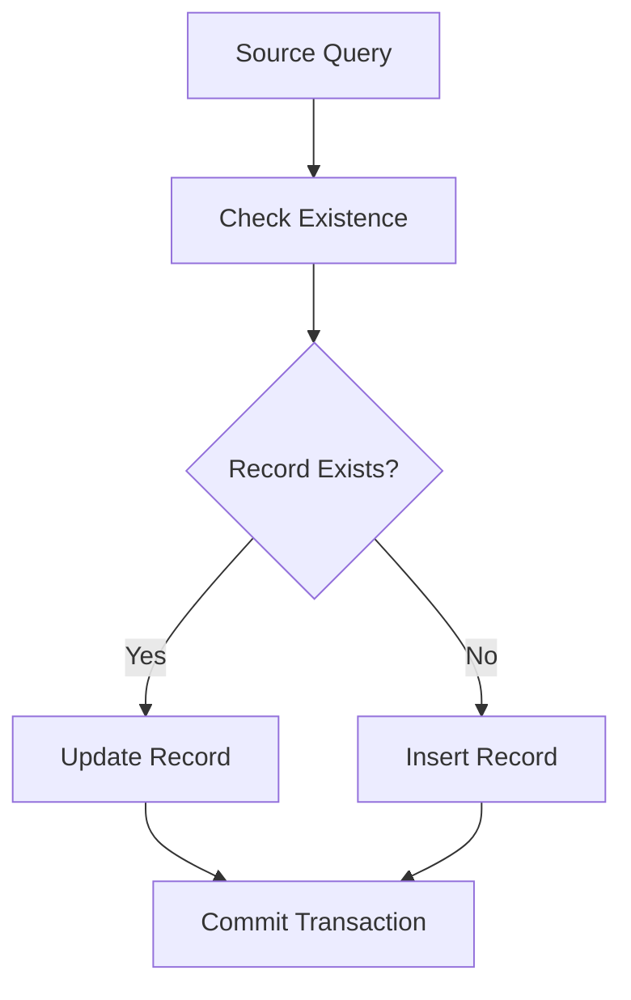

# 🔄 Multi-Database Synchronization Implementation Guide

## 📋 Table of Contents

1. [Overview](#overview)
2. [Key Components](#components)
3. [Database Connection Setup](#setup)
4. [Data Synchronization Process](#sync)
5. [Error Handling](#errors)
6. [Best Practices](#practices)
7. [Implementation Details](#details)
8. [Usage Example](#usage)

## 🎯 Overview {#overview}

[⬆️ Back to TOC](#-table-of-contents)

This implementation provides a robust solution for synchronizing data between two databases using the MultiDatabaseConnector class.

| Feature | Description |
|---------|------------|
| Multi-Connection Support | ✅ Handles multiple database connections simultaneously |
| Transaction Safety | 🔒 Ensures data integrity with transaction management |
| Flexible Engine Support | 🔌 Supports various database engines |
| Error Handling | ⚠️ Comprehensive error management |

## 🔧 Key Components {#components}

[⬆️ Back to TOC](#-table-of-contents)

### Core Classes

```python
MultiDatabaseConnector
├── attach_database()
├── prepare_connection()
├── connect()
└── transaction()
```

## 🔌 Database Connection Setup {#setup}

[⬆️ Back to TOC](#-table-of-contents)

### Connection Process

1. 🏗️ Initialize Connector

   ```python
   multi_db = MultiDatabaseConnector()
   ```

2. 🔗 Attach Source Database

   ```python
   multi_db.attach_database(
       alias="source_db",
       engine_type=TargetDatabaseEngine.SQLITE3,
       connect_option=TargetDatabaseConnectionStringOption.DefaultFormatAndDefaultUserPwd
   )
   ```

3. 🎯 Attach Target Database

   ```python
   multi_db.attach_database(
       alias="target_db",
       engine_type=TargetDatabaseEngine.POSTGRESQL,
       connect_option=TargetDatabaseConnectionStringOption.DefaultFormatAndChangeUserPwd
   )
   ```

## 🔄 Data Synchronization Process {#sync}

[⬆️ Back to TOC](#-table-of-contents)

### Synchronization Flow



## ⚠️ Error Handling {#errors}

[⬆️ Back to TOC](#-table-of-contents)

| Error Type | Handling Strategy |
|------------|------------------|
| Connection Errors | 🔄 Automatic retry with backoff |
| Transaction Errors | ↩️ Automatic rollback |
| Validation Errors | ❌ Immediate abort with logging |

## 💡 Best Practices {#practices}

[⬆️ Back to TOC](#-table-of-contents)

1. 🔒 Always use transactions for data modifications
2. 📊 Validate data before synchronization
3. 🔍 Log all operations for debugging
4. 🔄 Implement retry mechanisms for transient failures

## 🔬 Implementation Details {#details}

[⬆️ Back to TOC](#-table-of-contents)

### Key Methods

| Method | Purpose | Usage |
|--------|---------|-------|
| `attach_database()` | Connect to database | Initial setup |
| `prepare_connection()` | Configure connection | Connection parameters |
| `transaction()` | Manage transactions | Data modifications |
| `execute_query()` | Run SQL queries | Data retrieval |

## 📝 Usage Example {#usage}

[⬆️ Back to TOC](#-table-of-contents)

### Basic Synchronization

```python
with multi_db.transaction("target_db"):
    if not record_exists:
        insert_record()
    else:
        update_record()
```

### Key Benefits

- ✅ Transaction Safety
- 🔄 Automatic Rollback
- 📊 Data Validation
- 🔍 Error Tracking

## Key Features Summary

| Feature | Icon | Description |
|---------|------|------------|
| Multi-Connection | 🔌 | Handle multiple databases |
| Transaction Safety | 🔒 | Ensure data integrity |
| Error Handling | ⚠️ | Comprehensive error management |
| Data Validation | ✅ | Verify data before sync |
| Performance | ⚡ | Optimized operations |
| Flexibility | 🔄 | Support multiple engines |
| Logging | 📝 | Track all operations |
| Security | 🛡️ | Secure credential handling |

---
*This implementation follows KISS and Occam's Razor principles while providing robust database synchronization functionality.*

[⬆️ Back to TOC](#-table-of-contents)
