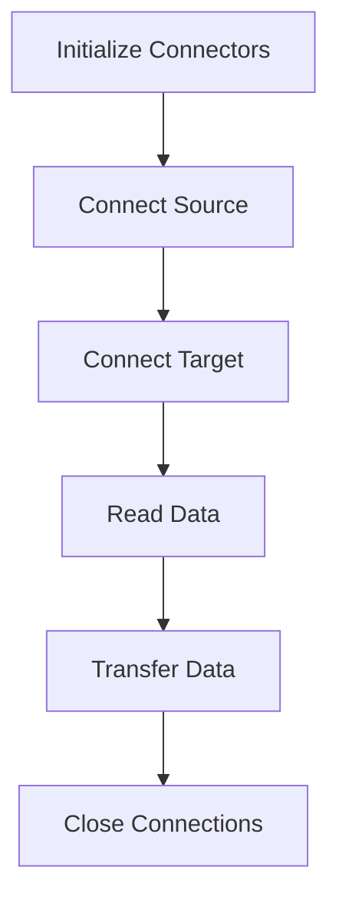
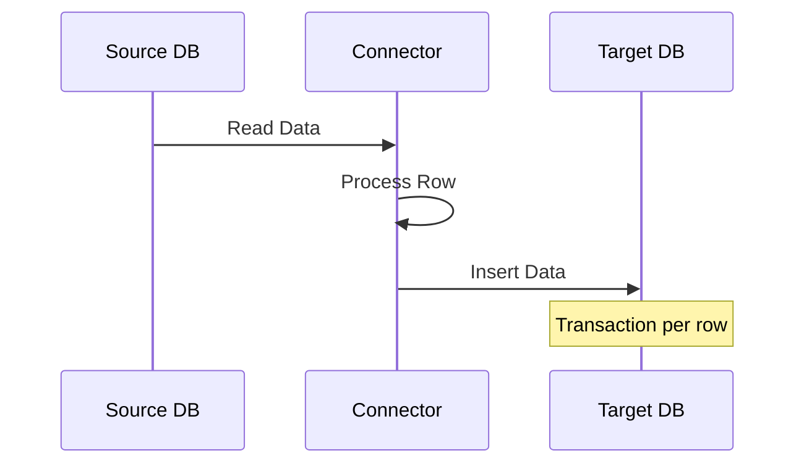

# 🔄 Two-Instance Database Connector Implementation Guide {#main}

## 📋 Table of Contents {#toc}

1. [🎯 Overview](#overview)
2. [🏗️ Architecture](#architecture)
3. [⚙️ Implementation Details](#implementation)
4. [🔌 Connection Management](#connections)
5. [📤 Data Transfer Process](#transfer)
6. [⚠️ Error Handling](#errors)
7. [💡 Best Practices](#practices)

## 🎯 Overview {#overview}

[⬆️ Back to Table of Contents](#toc)

An implementation demonstrating database-to-database data transfer using two independent DatabaseConnector instances, focused on SQLite3 to PostgreSQL transfer, following KISS principles.

## 🏗️ Architecture {#architecture}

[⬆️ Back to Table of Contents](#toc)

### 🧩 Component Structure

| Component | Purpose |
|-----------|----------|
| 📥 Source Connector | Manages source database connection (SQLite3) |
| 📤 Target Connector | Manages target database connection (PostgreSQL) |
| 🔄 Connection Context | Handles connection lifecycle |
| 🔒 Transaction Context | Ensures data integrity |

### 📊 Implementation Pattern



## ⚙️ Implementation Details {#implementation}

[⬆️ Back to Table of Contents](#toc)

### 🛠️ Connector Initialization

```python
from db_connector.core.connector import DatabaseConnector
from db_connector.templates.constraints import (
    TargetDatabaseEngine,
    TargetDatabaseConnectionStringOption,
)

source_db = DatabaseConnector(
    target_database_engine=TargetDatabaseEngine.SQLITE3,
    target_database_engine_connect_option=TargetDatabaseConnectionStringOption.DefaultFormatAndDefaultUserPwd
)

target_db = DatabaseConnector(
    target_database_engine=TargetDatabaseEngine.POSTGRESQL,
    target_database_engine_connect_option=TargetDatabaseConnectionStringOption.DefaultFormatAndDefaultUserPwd
)
```

### ✨ Key Features

- ✅ Independent connector instances
- ✅ Type-safe engine selection
- ✅ Configurable connection options
- ✅ Clean connection management

## 🔌 Connection Management {#connections}

[⬆️ Back to Table of Contents](#toc)

### 🔄 Connection Flow

1. **📥 Source Connection**

   ```python
   with source_db.finalization_of_connection_parameters(
       database="source.db"
   ).connect_to_database() as source:
   ```

2. **📤 Target Connection**

   ```python
   with target_db.finalization_of_connection_parameters(
       host="localhost",
       port=5432,
       database="target_db"
   ).set_credentials_based_on_connect_option().connect_to_database() as target:
   ```

## 📤 Data Transfer Process {#transfer}

[⬆️ Back to Table of Contents](#toc)

### 🔄 Process Flow

1. **📖 Read Source Data**

   ```python
   source_data = source.execute_query_to_dataframe(
       "SELECT id, name, value FROM source_table"
   )
   ```

2. **📝 Transfer Data**

   ```python
   for _, row in source_data.iterrows():
       with target.transaction():
           target.insert(
               "target_table",
               {
                   "id": row["id"],
                   "name": row["name"],
                   "value": row["value"],
               },
           )
   ```

### 📊 Data Flow Diagram



## ⚠️ Error Handling {#errors}

[⬆️ Back to Table of Contents](#toc)

### 🛡️ Error Strategy

| Error Type | Handling | Recovery |
|------------|----------|----------|
| 🔴 DatabaseError | Transaction rollback | Automatic |
| 🟡 ConnectionError | Cleanup & retry | Automatic |
| 🔵 General Exception | Process termination | Manual |

### 🔧 Implementation

```python
try:
    # Database operations
except DatabaseError as e:
    print(f"Database error: {e}")
except Exception as e:
    print(f"Unexpected error: {e}")
```

## 💡 Best Practices {#practices}

[⬆️ Back to Table of Contents](#toc)

### 🎯 Key Principles

1. **🔒 Resource Management**
   - Use context managers for connections
   - Explicit connection cleanup
   - Transaction integrity

2. **⚠️ Error Handling**
   - Specific error types
   - Graceful error reporting
   - Resource cleanup on failure

3. **🔐 Data Integrity**
   - Transaction per row
   - Proper type handling
   - Clean connection management

## 📝 Summary

[⬆️ Back to Table of Contents](#toc)

This implementation provides:

- 🧹 Clean, maintainable code
- 🛡️ Robust error handling
- 🚀 Efficient data transfer
- 🔒 Resource management

Following KISS principles while maintaining functionality and reliability.

---

*📚 Documentation for the Two-Instance Database Connector implementation.*

[⬆️ Back to Top](#main)
