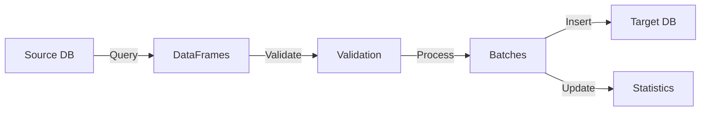

# 🔄 Database Data Transfer Implementation

> A KISS and Occam's Razor compliant solution for database-to-database data transfer

## 📑 Table of Contents

1. [Overview](#overview)
2. [Core Components](#core-components)
3. [Key Functions](#key-functions)
4. [Data Flow](#data-flow)
5. [Error Handling](#error-handling)
6. [Progress Tracking](#progress-tracking)
7. [Usage Example](#usage-example)
8. [Best Practices](#best-practices)

## 🎯 Overview [↩](#-table-of-contents)

The implementation provides a straightforward approach to transfer data between different database instances using the DatabaseConnector class. It follows KISS (Keep It Simple, Stupid) and Occam's Razor principles.

### Key Features

- ✅ Simple, focused functions
- 📊 Batch processing
- 🔍 Data validation
- 📈 Progress tracking
- ❌ Error handling
- 🔄 Transaction support

## 🧩 Core Components [↩](#-table-of-contents)

| Component | Purpose | Key Features |
|-----------|---------|--------------|
| DatabaseConnector | Database connection management | Connection pooling, Transaction handling |
| create_target_table | Table creation | Schema definition, Safe creation |
| validate_data | Data validation | Column verification, Null checks |
| process_batch | Batch processing | Chunked operations, Transaction safety |
| transfer_data | Orchestration | Progress tracking, Error handling |

## 🔧 Key Functions [↩](#-table-of-contents)

### 1. create_target_table

```python
def create_target_table(db: DatabaseConnector, table_name: str, columns: Dict[str, str]) -> None
```

- 🎯 Purpose: Creates target table if it doesn't exist
- 🔒 Safety: Uses `IF NOT EXISTS`
- 📦 Transactions: Wrapped in transaction

### 2. validate_data

```python
def validate_data(data: pd.DataFrame, required_columns: List[str]) -> bool
```

- ✅ Validates column presence
- 🔍 Checks for null values
- ❌ Raises clear error messages

### 3. process_batch

```python
def process_batch(target_db: DatabaseConnector, table_name: str, data: pd.DataFrame, batch_size: int = 1000) -> int
```

- 📦 Processes data in chunks
- 🔄 Transaction per batch
- 📊 Returns processed count

### 4. transfer_data

```python
def transfer_data(source_db: DatabaseConnector, target_db: DatabaseConnector, ...) -> Dict[str, Any]
```

- 🎮 Main orchestration function
- 📈 Tracks progress
- ⏱️ Measures duration
- 📝 Logs operations

## 🔄 Data Flow [↩](#-table-of-contents)



## ❌ Error Handling [↩](#-table-of-contents)

| Error Type | Handling Strategy |
|------------|------------------|
| DatabaseError | Specific database errors |
| ValueError | Data validation issues |
| Exception | Generic error catch |

## 📊 Progress Tracking [↩](#-table-of-contents)

Statistics tracked:

- Total rows
- Processed rows
- Start/End time
- Status
- Errors
- Duration

## 💡 Usage Example [↩](#-table-of-contents)

```python
# Initialize connectors
source_db = DatabaseConnector(TargetDatabaseEngine.SQLITE3, ...)
target_db = DatabaseConnector(TargetDatabaseEngine.POSTGRESQL, ...)

# Define mapping
column_mapping = {
    "id": "INTEGER PRIMARY KEY",
    "name": "VARCHAR(100)"
}

# Transfer data
stats = transfer_data(
    source_db=source_db,
    target_db=target_db,
    source_query="SELECT * FROM source_table",
    target_table="target_table",
    column_mapping=column_mapping
)
```

## ✨ Best Practices [↩](#-table-of-contents)

1. **Transaction Safety**
   - 🔒 Use transactions for batches
   - 🔄 Proper rollback on errors

2. **Resource Management**
   - 📦 Batch processing for large datasets
   - 🔌 Context managers for connections

3. **Error Handling**
   - 📝 Detailed error logging
   - 🔍 Specific error types
   - 🔄 Clean rollback on failure

4. **Progress Monitoring**
   - 📊 Track progress metrics
   - ⏱️ Measure operation duration
   - 📝 Log key operations

5. **Validation**
   - ✅ Validate before transfer
   - 🔍 Check data integrity
   - ❌ Clear error messages

---

> 📝 Note: This implementation follows KISS and Occam's Razor principles while maintaining robustness and reliability in data transfer operations.

## [↩](#-table-of-contents)
