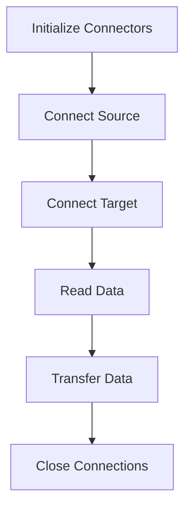
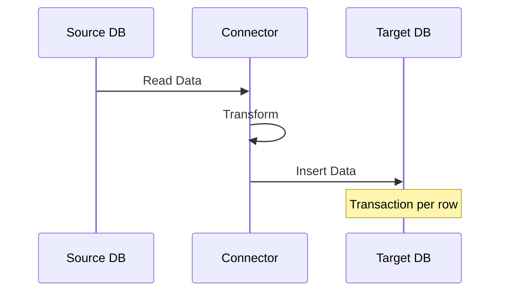

# 🔄 Two-Instance Database Connector Implementation Guide

## 📋 Table of Contents

1. [Overview](#overview)
2. [Architecture](#architecture)
3. [Implementation Details](#implementation)
4. [Connection Management](#connection)
5. [Data Transfer Process](#transfer)
6. [Error Handling](#errors)
7. [Best Practices](#best-practices)

## 🎯 Overview {#overview}

[↑ Back to TOC](#table-of-contents)

An implementation demonstrating database-to-database data transfer using two independent DatabaseConnector instances, following KISS and Occam's Razor principles.

## 🏗️ Architecture {#architecture}

[↑ Back to TOC](#table-of-contents)

### Component Structure

| Component | Purpose |
|-----------|----------|
| Source Connector | Manages source database connection (SQLite3) |
| Target Connector | Manages target database connection (PostgreSQL) |
| Connection Context | Handles connection lifecycle |
| Transaction Context | Ensures data integrity |

### Implementation Pattern



## 🔍 Implementation Details {#implementation}

[↑ Back to TOC](#table-of-contents)

### Connector Initialization

```python
source_db = DatabaseConnector(
    target_database_engine=TargetDatabaseEngine.SQLITE3,
    target_database_engine_connect_option=TargetDatabaseConnectionStringOption.DefaultFormatAndDefaultUserPwd
)
```

### Key Features

- ✅ Independent connector instances
- ✅ Type-safe engine selection
- ✅ Configurable connection options
- ✅ Clean connection management

## 🔌 Connection Management {#connection}

[↑ Back to TOC](#table-of-contents)

### Connection Flow

1. **Source Connection**

   ```python
   with source_db.finalization_of_connection_parameters(
       database="source.db"
   ).connect_to_database() as source:
   ```

2. **Target Connection**

   ```python
   with target_db.finalization_of_connection_parameters(
       host="localhost",
       port=5432,
       database="target_db"
   ).set_credentials_based_on_connect_option().connect_to_database() as target:
   ```

## 🔄 Data Transfer Process {#transfer}

[↑ Back to TOC](#table-of-contents)

### Process Flow

1. **Read Source Data**

   ```python
   source_data = source.execute_query_to_dataframe(
       "SELECT id, name, value FROM source_table"
   )
   ```

2. **Insert to Target**

   ```python
   with target.transaction():
       target.insert(
           "target_table",
           {
               "id": row["id"],
               "name": row["name"],
               "value": row["value"]
           }
       )
   ```

### Data Flow Diagram



## ⚠️ Error Handling {#errors}

[↑ Back to TOC](#table-of-contents)

### Error Strategy

| Error Type | Handling |
|------------|----------|
| DatabaseError | Specific database errors |
| General Exception | Unexpected errors |
| Connection Issues | Automatic cleanup |

### Implementation

```python
try:
    # Database operations
except DatabaseError as e:
    print(f"Database error: {e}")
except Exception as e:
    print(f"Unexpected error: {e}")
```

## 💡 Best Practices {#best-practices}

[↑ Back to TOC](#table-of-contents)

### Key Principles

1. **Resource Management**
   - Use context managers for connections
   - Explicit connection cleanup
   - Transaction integrity

2. **Error Handling**
   - Specific error types
   - Graceful error reporting
   - Resource cleanup on failure

3. **Data Integrity**
   - Transaction per operation
   - Validation before transfer
   - Proper type handling

### 📊 Performance Considerations

- Transaction management per row
- DataFrame for bulk reading
- Context managers for resource cleanup

---
*This implementation follows KISS and Occam's Razor principles while maintaining robust functionality.*

[↑ Back to TOC](#table-of-contents)
