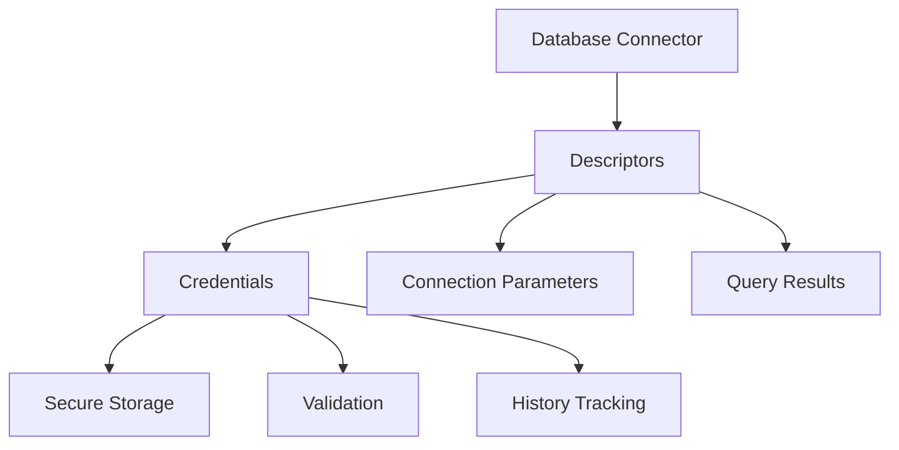
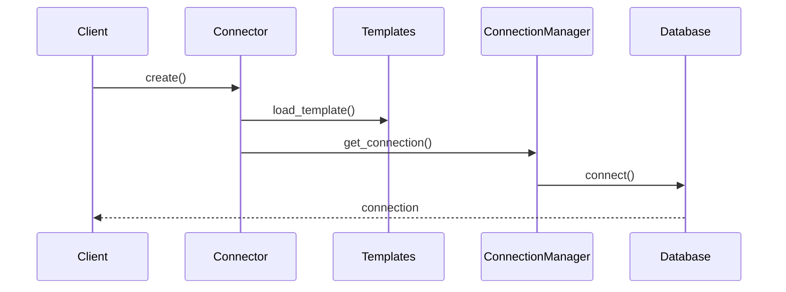

# 🏗️ Database Connector Project Architecture

## Current Issues
1. `descriptors.py` contains mixed concerns (credentials, parameters, connection management)
2. Base functionality is spread across files
3. Naming doesn't clearly indicate module purposes
4. Project structure needs better organization

## Recommended Project Structure

```
database_connector/
│
├── core/
│   ├── __init__.py
│   ├── base.py                    # BaseDatabaseConnector (moved from base_database_connector.py)
│   ├── exceptions.py              # All custom exceptions
│   └── descriptors/
│       ├── __init__.py
│       ├── credentials.py         # Credential management descriptors
│       ├── connection.py          # Connection parameter descriptors
│       └── results.py            # Query result descriptors
│
├── connectors/
│   ├── __init__.py
│   ├── database_connector.py      # Single database connector
│   └── multi_database_connector.py # Multi-database connector
│
├── templates/
│   ├── __init__.py
│   ├── engine_templates.py        # Database engine templates
│   └── connection_templates.py    # Connection string templates
│
├── utils/
│   ├── __init__.py
│   ├── connection_manager.py      # Connection management utilities
│   └── validation.py             # Validation utilities
│
└── config/
    ├── __init__.py
    ├── engine_types.py           # Engine type enums
    └── connection_options.py     # Connection option enums
```

## Module Renaming and Reorganization

### 1. Split `descriptors.py` into:

```python
# core/descriptors/credentials.py
class CredentialsDescriptor(BaseDescriptor):
    """Manages database credentials securely."""
    pass

# core/descriptors/connection.py
class ConnectionParametersDescriptor(BaseDescriptor):
    """Manages database connection parameters."""
    pass

# core/descriptors/results.py
class QueryResultDescriptor(BaseDescriptor):
    """Manages database query results."""
    pass
```

### 2. Move Connection Management to Utilities:

```python
# utils/connection_manager.py
class ConnectionManager:
    """Handles database connection management and credentials."""
    pass
```

### 3. Consolidate Base Functionality:

```python
# core/base.py
class BaseDatabaseConnector(ABC):
    """Abstract base class for all database connectors."""
    pass
```

## Benefits of New Structure

1. **Clear Separation of Concerns**
   - Base functionality in core
   - Connector implementations separate
   - Templates isolated
   - Utilities distinct

2. **Better Maintainability**
   - Each module has single responsibility
   - Clear dependency paths
   - Easier testing

3. **Improved Scalability**
   - Easy to add new connectors
   - Template system extensible
   - Clear extension points

4. **Enhanced Reusability**
   - Core components isolated
   - Utilities independent
   - Templates reusable

## Usage Example

```python
from database_connector.connectors import DatabaseConnector
from database_connector.config.engine_types import TargetDatabaseEngine
from database_connector.config.connection_options import TargetDatabaseConnectionStringOption

# Create connector
connector = DatabaseConnector(
    engine_type=TargetDatabaseEngine.MSSQL,
    connect_option=TargetDatabaseConnectionStringOption.Customize_DSN_AndChangeUserPwd
)

# Use connection manager
from database_connector.utils.connection_manager import ConnectionManager
manager = ConnectionManager()
credentials = manager.set_credentials()
```

## Key Improvements

1. **Module Organization**
   - Logical grouping of related code
   - Clear module purposes
   - Better discoverability

2. **Naming Conventions**
   - More descriptive file names
   - Consistent naming scheme
   - Clear purpose indication

3. **Dependency Management**
   - Clear import paths
   - Reduced circular dependencies
   - Better encapsulation

4. **Extension Points**
   - Easy to add new descriptors
   - Simple template additions
   - Clear extension patterns

# 🏗️ Database Connector Architecture Deep Dive

## 1. 📦 Detailed Module Implementation

### Core Base Implementation
```python
# database_connector/core/base.py

from abc import ABC, abstractmethod
from typing import Dict, Any, Optional
from contextlib import contextmanager
import logging

class BaseDatabaseConnector(ABC):
    """Core abstract base class for all database connectors."""
    
    def __init__(self):
        self._logger = logging.getLogger(self.__class__.__name__)
        self.initialize_descriptors()
        
    def initialize_descriptors(self):
        """Initialize all descriptor instances."""
        self._credentials = CredentialsDescriptor("credentials")
        self._connection_params = ConnectionParametersDescriptor("connection_params")
        self._query_results = QueryResultDescriptor("query_results")
        
    @abstractmethod
    def connect(self) -> 'BaseDatabaseConnector':
        """Establish database connection."""
        pass
        
    @abstractmethod
    def _load_engine_config(self) -> Dict[str, Any]:
        """Load engine-specific configuration."""
        pass
        
    @contextmanager
    def transaction(self):
        """Base transaction context manager."""
        pass
```

### Descriptor Implementation
```python
# database_connector/core/descriptors/credentials.py

from dataclasses import dataclass
from datetime import datetime
from typing import Optional

@dataclass
class Credentials:
    username: Optional[str]
    password: Optional[str]
    is_default: bool = True
    last_updated: datetime = datetime.now()

class CredentialsDescriptor:
    """Secure credential management descriptor."""
    
    def __init__(self, name: str):
        self.name = f"_{name}"
        
    def __get__(self, instance, owner):
        if not hasattr(instance, self.name):
            setattr(instance, self.name, Credentials(None, None))
        return getattr(instance, self.name)
        
    def __set__(self, instance, value):
        if isinstance(value, dict):
            current = getattr(instance, self.name, Credentials(None, None))
            setattr(instance, self.name, Credentials(
                username=value.get('username', current.username),
                password=value.get('password', current.password),
                is_default=False,
                last_updated=datetime.now()
            ))
```

## 2. 🎯 Architectural Decisions Explained

### A. Descriptor Pattern Choice


**Rationale:**
1. **Encapsulation**: Descriptors provide clean attribute access control
2. **Validation**: Centralized validation logic
3. **Type Safety**: Strong typing with dataclasses
4. **Auditability**: Built-in history tracking

### B. Template System Design
```python
# database_connector/templates/engine_templates.py

class TemplateManager:
    """Manages database engine templates."""
    
    @classmethod
    def get_template(cls, engine_type: str) -> Dict[str, Any]:
        """
        Get engine-specific template.
        
        Design Choices:
        1. Class-based for singleton behavior
        2. Template validation on load
        3. Lazy loading for performance
        4. Extensible format
        """
        return cls._load_template(engine_type)
```

**Benefits:**
1. **Separation of Concerns**: Templates isolated from core logic
2. **Extensibility**: Easy to add new engine support
3. **Maintainability**: Centralized template management
4. **Validation**: Template integrity checking

### C. Connection Management Strategy
```python
# database_connector/utils/connection_manager.py

class ConnectionManager:
    """
    Manages database connections.
    
    Design Choices:
    1. Pool management
    2. Connection lifecycle tracking
    3. Resource cleanup
    4. Error recovery
    """
    
    def __init__(self):
        self._pool = ConnectionPool()
        self._active_connections = {}
        
    def get_connection(self, key: str) -> Connection:
        """
        Get or create connection.
        
        Implementation considers:
        1. Connection pooling
        2. Timeout handling
        3. Retry logic
        4. Health checks
        """
        return self._pool.get_or_create(key)
```

## 3. 🔄 Component Interactions

### A. Connection Flow


### B. Transaction Management
```python
# Example of component interaction in transactions

class DatabaseConnector:
    """Shows how components interact in transactions."""
    
    def __init__(self):
        self._connection_manager = ConnectionManager()
        self._template_manager = TemplateManager()
        
    @contextmanager
    def transaction(self):
        """
        Transaction management showing component interaction.
        
        Flow:
        1. Connection validation
        2. Transaction start
        3. Operation execution
        4. Commit/rollback
        5. Resource cleanup
        """
        connection = self._connection_manager.get_connection()
        
        try:
            connection.begin()
            yield
            connection.commit()
        except Exception as e:
            connection.rollback()
            raise
        finally:
            self._connection_manager.release(connection)
```

### C. Error Handling Integration
```python
# database_connector/core/exceptions.py

class ErrorHandler:
    """
    Centralized error handling showing component interaction.
    
    Features:
    1. Error categorization
    2. Recovery strategies
    3. Logging integration
    4. Resource cleanup
    """
    
    @classmethod
    def handle_error(cls, error: Exception, context: Dict[str, Any]):
        """
        Coordinated error handling across components.
        
        Process:
        1. Log error
        2. Cleanup resources
        3. Notify monitoring
        4. Attempt recovery
        """
        cls._log_error(error)
        cls._cleanup_resources(context)
        cls._notify_monitoring(error)
        return cls._attempt_recovery(error, context)
```

### D. Query Execution Flow
```python
# Example of query execution component interaction

class QueryExecutor:
    """
    Demonstrates how components interact during query execution.
    
    Flow:
    1. Query validation
    2. Parameter binding
    3. Execution
    4. Result processing
    5. Resource cleanup
    """
    
    def execute(self, query: str, params: Dict[str, Any]):
        # Validate query
        self._validator.validate_query(query)
        
        # Prepare parameters
        bound_params = self._parameter_binder.bind(params)
        
        # Execute
        with self._connection_manager.get_connection() as conn:
            result = conn.execute(query, bound_params)
            
        # Process results
        return self._result_processor.process(result)
```

## Key Architectural Benefits

1. **Modularity**
   - Clean separation of concerns
   - Independent testing possible
   - Easy to maintain and extend

2. **Type Safety**
   - Strong typing throughout
   - Runtime validation
   - Clear interfaces

3. **Resource Management**
   - Automatic cleanup
   - Connection pooling
   - Transaction safety

4. **Error Handling**
   - Centralized error management
   - Recovery strategies
   - Comprehensive logging

