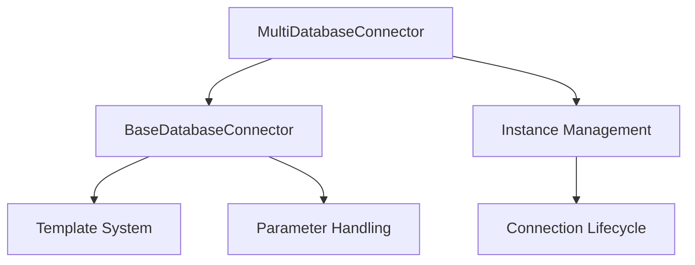

# MultiDatabaseConnector.md

```markdown
# 🔌 MultiDatabaseConnector Documentation

## 📑 Table of Contents
1. [🎯 Overview](#overview)
2. [🏗️ Architecture](#architecture)
3. [🔗 Connection Patterns](#patterns)
4. [💻 Usage Examples](#usage)
5. [📐 Template System](#templates)
6. [⚡ Operations](#operations)
7. [🔍 Error Handling](#errors)
8. [📊 Instance Management](#instances)

## 🎯 Overview <a name="overview"></a>
[↑ Back to Top](#table-of-contents)

The MultiDatabaseConnector extends BaseDatabaseConnector to provide simultaneous connections to multiple databases with template-driven configuration. It maintains connection lifecycles, supports dynamic parameter handling, and provides comprehensive error management.

### Key Features
- 🔄 Multiple concurrent database connections
- 📝 Template-based configuration
- 🛡️ Type-safe operations
- 🔍 Connection lifecycle management

### Class Hierarchy


## 🏗️ Architecture <a name="architecture"></a>
[↑ Back to Top](#table-of-contents)

### Core Components

```python
class MultiDatabaseConnector(BaseDatabaseConnector):
    def __init__(self):
        super().__init__()
        self.instances: Dict[str, Dict[str, Any]] = {}
        self.connections: Dict[str, Any] = {}
        self.active_instance: Optional[str] = None
        self._transaction_instance: Optional[str] = None
        self._logger = logging.getLogger(__name__)
```

### Instance Structure
```python
self.instances[database_alias] = {
    'name': database_alias,
    'engine_type': engine_type,
    'connect_option': connect_option,
    'engine_config': self.engine_config,
    'is_active': True,
    'attached_at': datetime.now(),
    'deattached_at': None  # Set at disconnect
}
```

## 🔗 Connection Patterns <a name="patterns"></a>
[↑ Back to Top](#table-of-contents)

### Basic Connection
```python
# Single database connection
mdb = MultiDatabaseConnector() \
    .attach(
        database_alias="primary_db",
        engine_type=TargetDatabaseEngine.MSSQL,
        connect_option=TargetDatabaseConnectionStringOption.DefaultFormatAndDefaultUserPwd
    ) \
    .finalization_of_connection_parameters(
        host="localhost",
        database="Northwind",
        timeout=30
    ) \
    .connect_to_database()
```

### DSN-Based Connection
```python
# Using DSN with credentials
mdb.attach(
    database_alias="reporting_db",
    engine_type=TargetDatabaseEngine.MSSQL,
    connect_option=TargetDatabaseConnectionStringOption.Default_DSN_AndChangeUserPwd
) \
.change_default_username_and_password(
    show_password=False
) \
.finalization_of_connection_parameters(
    dsn="ReportingDSN"
) \
.connect_to_database()
```

## 💻 Usage Examples <a name="usage"></a>
[↑ Back to Top](#table-of-contents)

### Multiple Database Operations
```python
# Initialize connector
mdb = MultiDatabaseConnector()

# Attach production database
mdb.attach(
    database_alias="prod_db",
    engine_type=TargetDatabaseEngine.MSSQL,
    connect_option=TargetDatabaseConnectionStringOption.DefaultFormatAndDefaultUserPwd
) \
.finalization_of_connection_parameters(
    host="prod.server",
    database="production",
    timeout=30
) \
.connect_to_database()

# Attach reporting database
mdb.attach(
    database_alias="report_db",
    engine_type=TargetDatabaseEngine.MYSQL,
    connect_option=TargetDatabaseConnectionStringOption.Default_DSN_AndChangeUserPwd
) \
.finalization_of_connection_parameters(
    dsn="ReportingDSN",
    charset="utf8mb4"
) \
.connect_to_database()

# Switch between databases
mdb.use("prod_db")
```

### Transaction Management
```python
# Single instance transaction
with mdb.transaction("prod_db"):
    # Execute parameterized query
    mdb.execute_query(
        """
        INSERT INTO orders (order_id, customer_id)
        VALUES (?, ?)
        """,
        parameters=[1001, 'CUST001']
    )
    
    # Batch operations
    orders_data = [
        (1002, 'CUST002'),
        (1003, 'CUST003')
    ]
    mdb.execute_many(
        """
        INSERT INTO orders (order_id, customer_id)
        VALUES (?, ?)
        """,
        parameters=orders_data
    )
```
```

